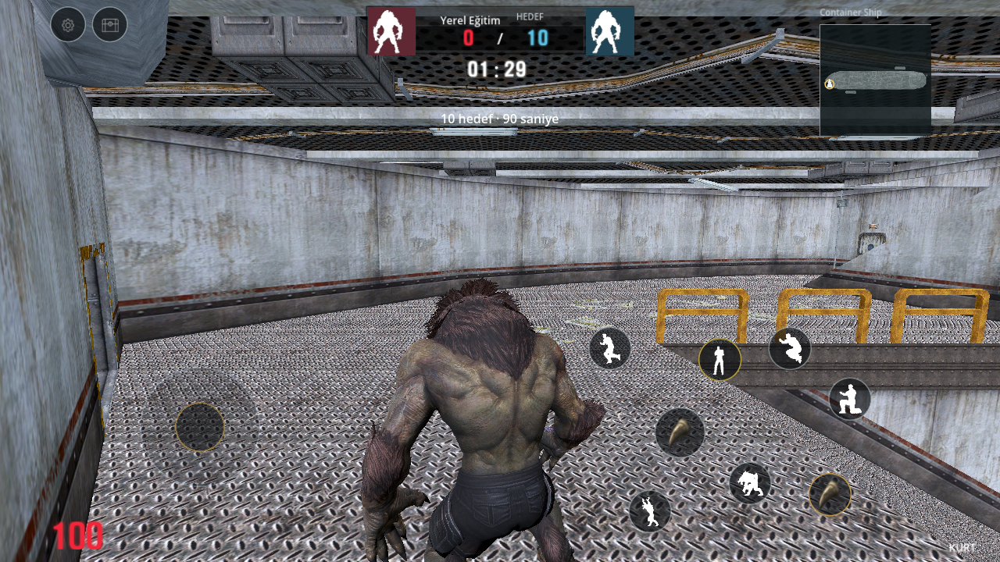
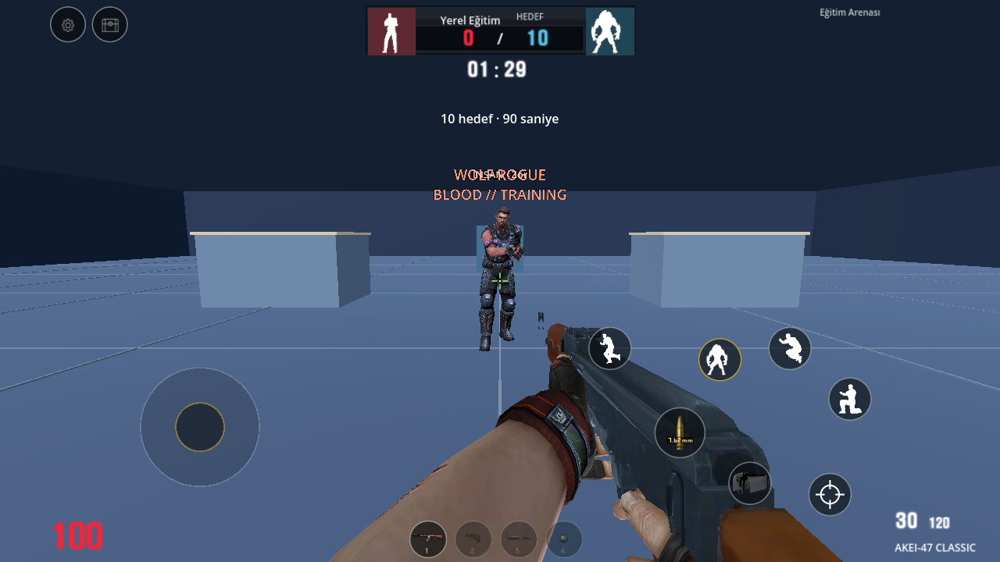
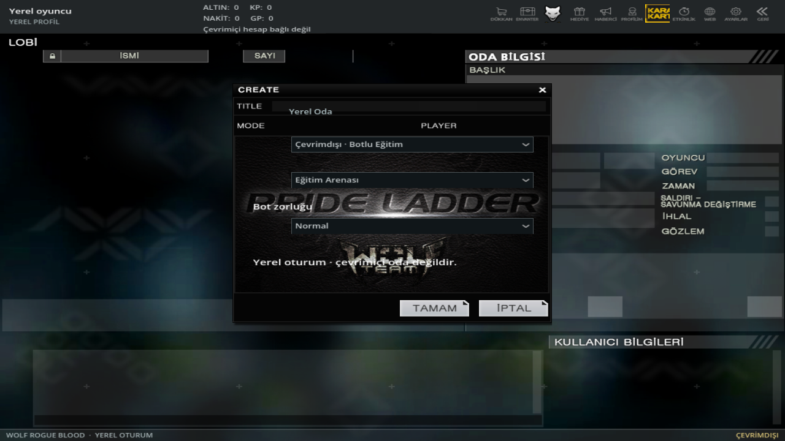

# Oynanış görünümü ve yerel botlar — 0.11

Referans: [kullanıcının düzelttiği TikTok videosu](https://vt.tiktok.com/ZSpYRNoHt/), `@wolftimemobile`, video `7704381905512172807`, yaklaşık 54,6 saniye. İncelenen oyun alanı dikey videonun `(0,712,1080,496)` bölümüdür; siyah bantlar, TikTok başlığı ve ağ hata ayıklama yazıları oyun arayüzüne eklenmez. Kullanıcı mevcut 19 haritanın korunmasını seçti; videodaki Giriş ve İki Tapınak eklenmedi.

## Uygulanan görünüm

- Tek joystick yeni kayıtların varsayılanı. Önceden dört yön düğmesi seçilmiş kayıt korunur; **Ayarlar → Kontrol → Joystick → Tamam** ile değiştirilebilir.
- Kullanıcının sonraki düzeltmesi doğrultusunda oyun içi bütün etkileşimli düğmeler yuvarlaktır. Hareket/eylem hedefleri, üst menü/envanter ve silah seçimi buna dahildir. Düğmeler fotoğraf veya simge taşır; genel metin kutuları kaldırıldı.
- İnsan silah saldırısı özgün `item/bullets/7.62.dtx`, kurt saldırısı özgün `item/bullets/wolf.dtx` görselini kullanır. Bıçak ve bomba seçilince eylem görseli de değişir. Şarjör görseli gerçek AK-47 şarjör geometrisinden, eylem pozları doğrulanmış insan/kurt modellerinden üretildi. Nişan simgesi yerel çizimdir. Bu küçük resimler özgün PC HUD sprite'ı diye işaretlenmez.
- Kurt kamerası yatayda ortalıdır; 0,55 m yükseltilmiş çarpışma kolu, 3,4 m uzaklık ve 70 derece düşey FOV yeni mobil kadraj ayarlarıdır. Duvar yakınında kamera kolu geri çekilir. İnsan görünümüne dönünce kamera kolu yüksekliği sıfırlanır. İlk bakışta açının sıçramaması için başlangıç eğimi gerçekten uygulanır.
- Kırmızı gerçek can, kaynak rakam atlasıyla mühimmat, kompakt yerel skor/hedef ve süre; üstte form siluetleri; köşede mevcut harita adı kullanılır. SP, sahte takım/oyuncu sayısı veya desteklenmeyen mod sonucu üretilmez.
- 19 mini harita, doğrulanmış yürüyüş ağının XZ izdüşümünden üretildi. Gerçek konum ve yön gösterilir; özgün PC radar kalibrasyonu ya da çok katlı radar eşitliği kanıtlanmış sayılmaz. Sahte oyuncu/bot radar işaretleri yoktur.
- İsabet işareti yalnızca gerçekten hasar veren isabette, hasar yönü biliniyorsa yön oku, gerçek hasarda kısa kenar kızarması görünür. Menü ve yeni tur bu geçici öğeleri temizler. Kurt görünümünde insan nişangâhı gizlenir.
- Boşta duran silahın yanında havada görünen yedek `MAG` parçası, ana şarjör ayrı mevcutsa sadece yeniden doldurma animasyonu sırasında gösterilir.

## Kullanıcının son istediği yerel botlar

Videodaki bot kodu kopyalanmadı. Sonraki açık istek üzerine yeni yerel insan/kurt bot davranışı eklendi. Oda oluştururken **Kolay / Normal / Zor** seçilir ve yeniden oynarken korunur.

| Profil | Oyun karar değeri | İlk tepki | Hedef hafızası | İsabet hasarı | Can |
| --- | ---: | ---: | ---: | ---: | ---: |
| Kolay | 80 | 0,70 sn | 2,5 sn | 8 | 100 |
| Normal | 95 | 0,40 sn | 5 sn | 8 | 100 |
| Zor | 110 | 0,22 sn | 8 sn | 8 | 100 |

Karar değerleri insan IQ testi değildir. Zorluk; tepki, nişan sapması, hafıza, siper örneklemesi ve takla kararıyla değişir. Sayılar özgün PC dengesi diye sunulmaz. Normal yürüyüş 3 m/sn, takip koşusu 5,2 m/sn; takla 0,6 saniye boyunca 6 m/sn yeni yerel ayarlardır.

Botlar görüş açısı/gerçek görüş hattı, duyulan atış konumu ve son görülen hedefi kullanır. Görünmeyen oyuncunun yeni konumu duvar arkasından takip edilmez. Yürüyüş ağından bağlı devriye yolları seçilir; siperin hem ulaşılabilirliği hem tehdidi gerçekten gizlemesi denetlenir. Alçak basamaklar kapsül/üst boşluk/zemin kontrolleriyle geçilir. Takla yolu engel ve desteklenen iniş noktasıyla kontrol edilir; takla hasar bağışıklığı vermez.

İnsan botlar kaynaktaki AK-47'den, birinci şahıs elleri ayıklanarak üretilmiş 2.123 üçgenlik tüfeği gerçek el kemiğine bağlar. Şarjör 30, yedek 90; kaynak atış aralığı 0,15 saniye, yeniden doldurma 2,5 saniyedir. Mühimmat harcanır ve yedekten tam bir kez aktarılır; boş yedekle sınırsız doldurma yoktur. Kaynak insan yeniden doldurma pozu ve özgün sesleri kullanılır. Kurtlar yakın saldırının vuruş penceresinde aynı 8 hasarı verir.

İnsan taklası kaynak çömelme pozu üzerinde yerel gövde dönüşüdür; bulunmayan özgün insan takla klibi diye gösterilmez. Kurt taklası mevcut özel saldırı pozu ve yerel gövde dönüşünü kullanır. Bütün kaynak haritaların her koridorunda uzun süreli bot maçı kabulü veya tam PC oyun davranışı eşitliği yapılmış sayılmaz.

## Güncel oyun içi fotoğraflar







## Kanıt ve yeniden üretim

[Bot davranışı](bot-validation.json), [harita/maç](offline-match-validation.json), [mobil regresyon](mobile-validation.json), [görüntüler](mobile-visual-validation.json) ve [APK](android-offline-build.json) raporları ayrıdır. Fiziksel telefon ve Android emülatörü testi yapılmadı.

```sh
godot --headless --path godot --script res://tests/prepare_radar.gd
godot --path godot --script res://tests/prepare_form_icons.gd
godot --path godot --script res://tests/prepare_bot_assets.gd
godot --path godot --script res://tests/prepare_control_icons.gd
godot --headless --path godot --script res://tests/prepare_arena_navigation.gd
python tools/validate_mobile.py --godot /path/to/godot-4.7.2 --report docs/mobile-validation.json
```

Görsel üretim komutları gerçek OpenGL görüntü aygıtı veya Xvfb ve yazılım OpenGL gerektirir. Telefonda yürüyüş ağı veya düğme görseli pişirilmez.
