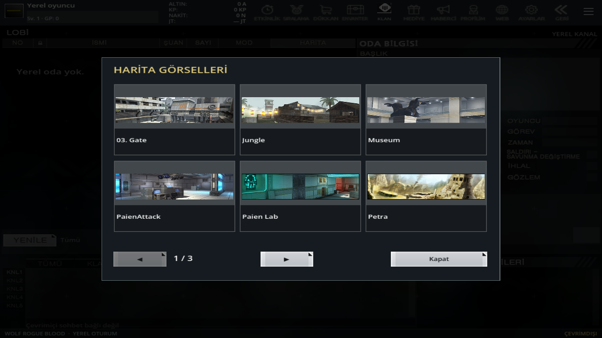
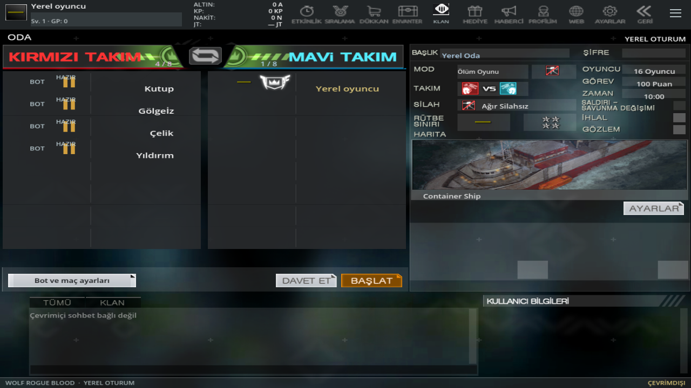
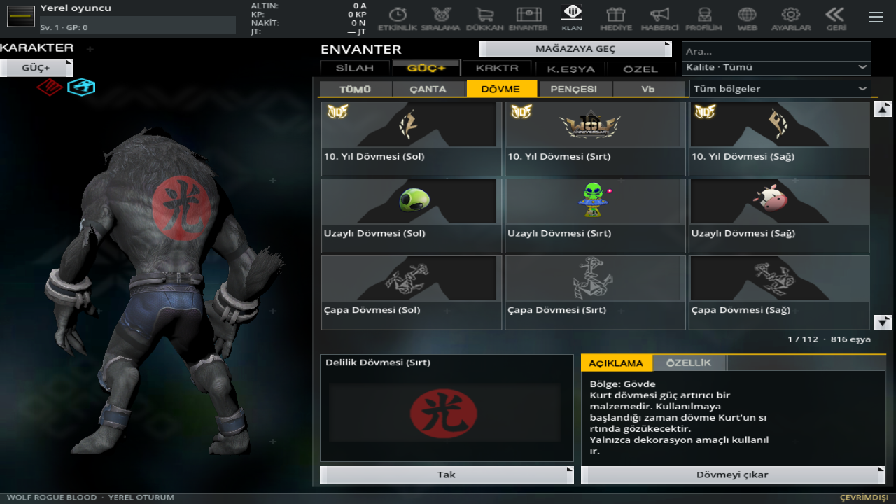
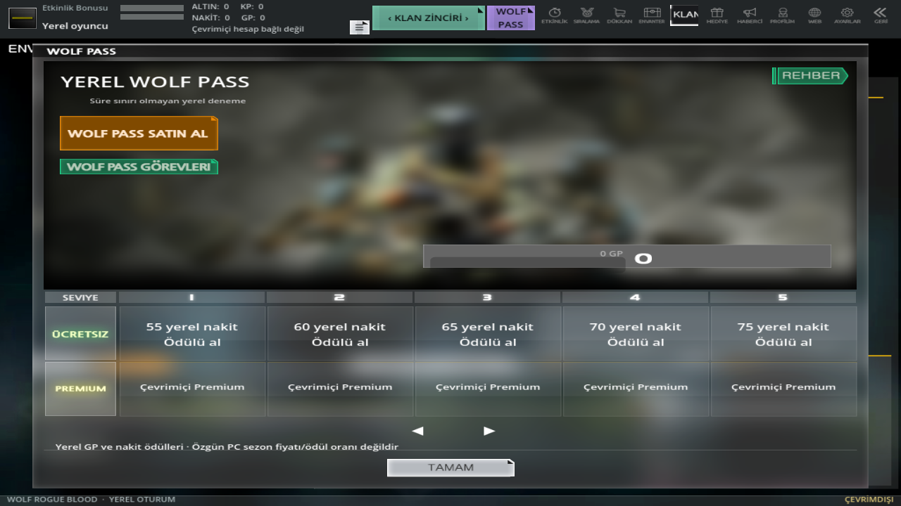
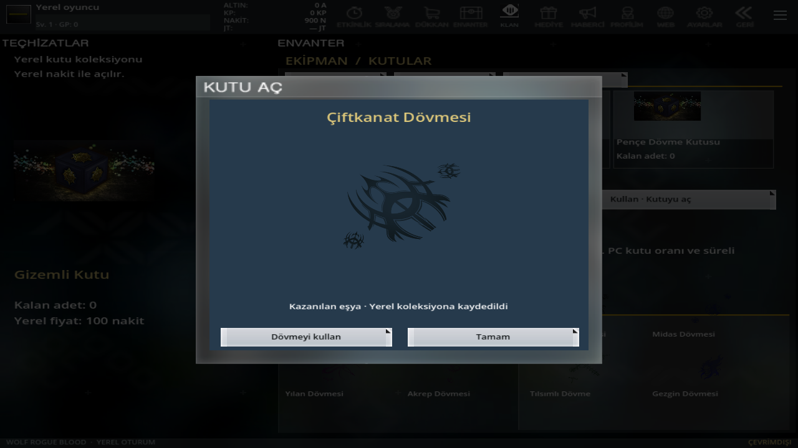

# 0.12 — PC referansları ve yeni yerel işlevler

Önceki beş PC videosu, önceki düzeltilmiş oynanış videosu ve yeni on bir erişilebilir video incelendi. [Bağlantılar, dosya özetleri ve tek tek gözlemler](pc-reference-expansion.json). Son `ZSpYQGn5s` bağlantısı bir fotoğraf gönderisidir: sayfa, embed/oEmbed ve yapılandırılmış TikTok verisi denendi; görsel yükü alınamadı. İçeriği görülmüş sayılmaz. Kullanıcının ayrıca eklediği oda/rütbe görüntüsü incelendi.

| Alan | 0.12 davranışı |
| --- | --- |
| Harita fotoğrafları | Seçili 19 haritanın özgün DTX fotoğrafları. Fotoğraf yolu, haritanın tam dünya dosyası üzerinden PC `mapattribute.dat` tablosuna bağlanır; isim benzerliği kullanılmaz. Fotoğraflı, sayfalı seçim galerisi; oda kurma, oda ve lobi önizlemesi. |
| Oda kurma | Ayrıntılı videodaki normal `interface/createfield` kullanılır. Önceki klan merdiveni penceresi kaldırıldı. Gerçek harita fotoğrafı, takım/form ve bot zorluğu bağlanır. |
| Rütbeler | Kaynak `class.txt` içindeki 62 normal rütbenin ad/simge/arka plan çifti; GM hariç. Başlıkta, oda satırında, profilde ve katalogda görünür. Yerel eşik `100 × sıra² GP`; özgün PC GP eşikleri çözüldü denmez. |
| İkinci şifre | İsteğe bağlı yerel profil kilidi. Kaynak dört yuvalı pencere, karıştırılan rakamlar, tekrar girişi, değiştirme/kaldırma, beş yanlış denemede 30 sn bekleme. Tuzlanmış özet saklanır; kayıt hatasında önceki kilit korunur. Çevrimiçi hesap yetkilendirmesi değildir. |
| Kutular | Yerel nakitle üç deneme kutusu alınır, adet harcanır, animasyon ve gerçek dövme sonucu gösterilir. Bakiye/adet/sonuç tek atomik kayıttadır; işlem tekrarı iki kez harcatmaz. Sonuç geçmişi ve dövmeyi kullanma vardır. PC Aurora/Nitro görseli, fiyatı, düşme oranı ve süreli sunucu kuponu kanıtlanmadı. Yerel kutular bunların aynısı diye etiketlenmez. |
| Kurt envanteri | Sırt/sol/sağ bölge filtresi, gerçek üç ekipman yuvası, sürüklenebilir model. 59 kol eşyasının tam PC kimliği ve `(Sol)/(Sağ)` adı doğrulandı; 48 modelde `Tattoo_Arm_L/R` yüzeyleri denetlendi. 54 önceden bilinen sırt dövmesi korunur. [Kaynak eşleme kanıtı](tattoo-slot-source.json). Diğer belirsiz bölgeler ve PC istatistik bonusları uydurulmaz. |
| Kurt Avı | Ayrı yerel mod: insan veya kurt tarafı, 3 raunt, her rauntta 4 rakip/90 sn, arada 3 sn duraklama, gerçek kazanma/kaybetme ve tekrar. Seçili 19 harita ve eğitim arenası. Kaynak özgün `Wolfhunt Revolt/Counter_Attack/Dominate` kuralları tamamlandı diye açılmaz. |
| Öğretici | `ZSpYaBxFM` videosunun üstünde aslında “Öğretici Mod” yazıyor. Yeni yerel öğretici, gerçek hareket/zıplama/dönüşüm/kükreme/takla/saldırı/insana dönüş/şarjör durumlarıyla sekiz adım ilerler. |
| Maç arayüzü | Gerçek öldürme akışı, Tab veya yuvarlak durum düğmesiyle skor/hasar/bot listesi; animasyonlu baş kemiğine göre kafadan isabet ve yerel ×2 çarpanı. Duvar/görüş sorgusu önce gerçek fizik hedefini belirler. Keskin nişancı nişanında dairesel maske, dürbün çizgileri ve 18 derece yerel FOV; silah görünümü bırakınca geri gelir. |
| Görevler ve Wolf Pass | Kaynak görev ve Wolf Pass pencereleri. Beş yerel görev; gerçek maç sonuçlarından kalıcı ilerleme. Her 100 GP için 10 ücretsiz yerel kademe, tek seferlik nakit ödülü. Ödül/bakiye birlikte kaydolur. Premium/özgün sezon ödül servisi çalışıyor gibi gösterilmez. |

## Ekran görüntüleri

## Doğrulama ve sınırlar

[Özellik regresyonu](pc-reference-expansion-validation.json), [tüm mobil kontroller](mobile-validation.json), [yeni ekranlar](pc-reference-visual-validation.json), [önceki bütün ekranların yeni görüntüleri](mobile-visual-validation.json), [gerçek APK denetimi](android-offline-build.json).

Görüntüler Godot/OpenGL çıktılarıdır; kutu çekiminde 1.000 yerel nakit test bakiyesi kullanılır. Kullanıcının çevrimiçi hesabı, sahipliği veya rütbesi değildir. Fiziksel Android cihazında/emülatörde kabul yapılmadı. Bir video, gösterilmeyen PC davranışını ve sayısal dengeyi ispatlamaz. Gerçek sunucu, bütün özgün modlar, ekipman bonusları, kart geliştirme ve her model/ışık/efektte piksel eşitliği tamamlanmış sayılmaz.

Yeni APK önceki çevrimdışı uygulamayla aynı kimlik ve sertifikayı kullanır; ayrı OBB gerekmez. Tam-PC teslim denetimi korunur.
