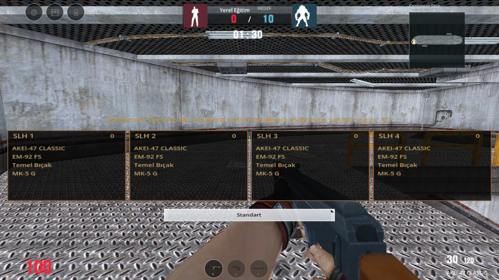
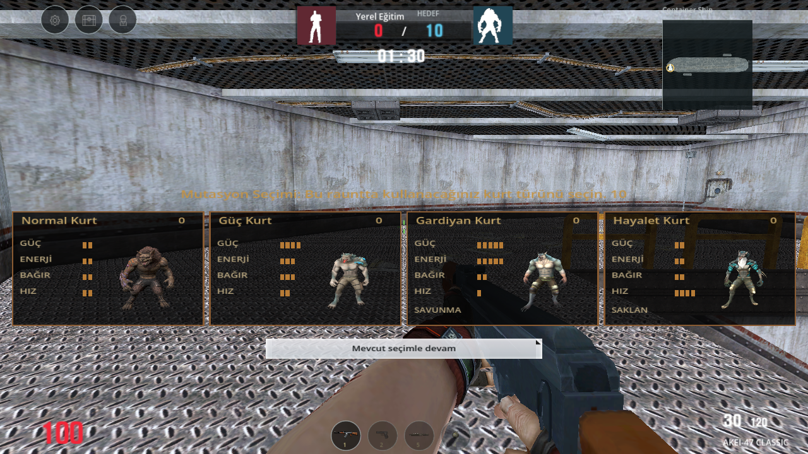
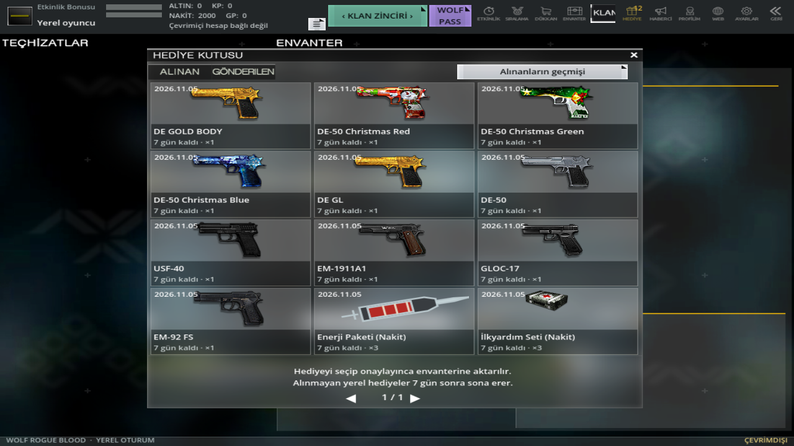
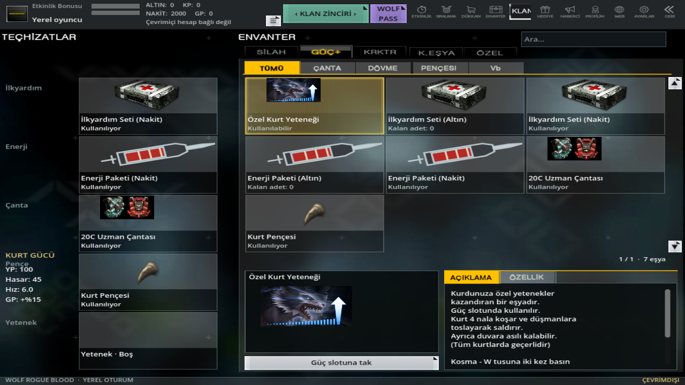
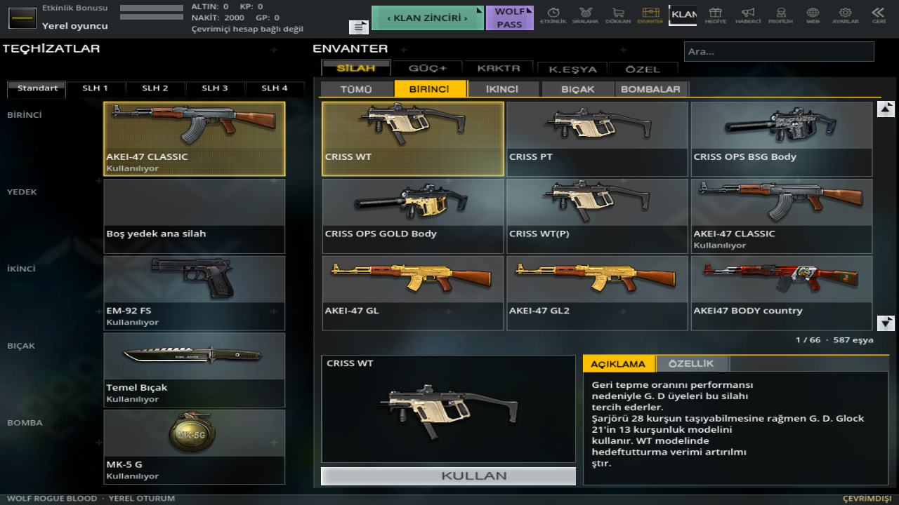

# 0.13 — Ekipman seçimi, kurt mutasyonları ve hediye kutusu

Kullanıcının 12478–12482 numaralı beş PC ekranı esas alındı. Gerçek sunucu eklenmedi; seçili 19 harita korundu.

| Referans | Bu sürümde çalışan akış |
| --- | --- |
| Silah seçimi | Maç başında oyun sahnesinin üzerinde dört saydam ekipman kartı, gerçek kaydedilmiş SLH 1–4 içerikleri, Standart seçeneği ve 10 saniyelik sayaç. Seçim sırasında oyuncu, bot, hasar ve maç süresi durur. Menü/arka plan sayacı da durdurur. Silah değiştirmek mühimmatı yenilemez. |
| Kurt seçimi | Normal, Güç, Gardiyan, Hayalet. PC model tanımlarındaki Model4–9 gövdeleri, açıkça işaret edilen animasyon bağışçıları ve DTX kaplamaları kullanılır. Her takımın kendi modeli vardır; kart görselleri bu modellerden Godot ile üretildi. İnsan→kurt dönüşümünde seçim açılır. Kurt Avı ve yeni yerel Kurt Savaşı modunda kurt tarafı doğrudan bu ekranla başlar. |
| Hediye kutusu | PC `interface/giftbox`, alınan/gönderilen sekmeleri, 3×4 kart, tarih, 7 günlük yerel süre, sayfalama ve alınanların geçmişi. Kutular ve güç eşyaları satın alındığında önce buraya gelir. Tamamlanan görevler sistem tarafından buraya gönderilir. Eşyayı seçip onaylamak envanter/bakiyeye aktarır. Aynı hediye iki kez alınamaz. Kayıt hatası, süre sonu ve envanter sınırı hediyeyi çoğaltmaz veya harcatmaz. |
| Güç envanteri | Tümü, Çanta, Dövme, Pençesi, Vb sekmeleri; ayrı ilkyardım, enerji, çanta, pençe ve mevcut kurt yeteneği yuvaları. Kaynak isim/açıklama: 19001/19002 ilkyardım, 19501/19502 enerji, 13006 çanta, 19602 pençe. Kabul edilen sonlu ilkyardım/enerji şarjları maçta yuvarlak görselli düğmelerle kullanılır. |
| İnsan yuvaları ve başlık | Standart/SLH 1–4; ana/yedek/tabanca/bıçak/bomba yuvaları. Özellik sekmesinde gerçek yerel hasar, şarjör, atış hızı, dolum süresi çubukları. Üst sıra Etkinlik, Sıralama, Dükkan, Envanter, Klan, Hediye, Haberci, Profil, Web, Ayarlar, Geri; ayrıca Klan Zinciri, Wolf Pass ve ek menü. Çevrimiçi hizmetler bağlı gibi gösterilmez. |

## Kaynak ve yerel denge

`godot/assets/mutations/catalog.json` model, bağışçı, iskelet, kaplama ve önizleme özetlerini tutar. `tools/import_wolf_mutations.py` kaynaktan tekrar dönüştürür; `godot/tests/bake_mutation_portraits.gd` gerçek model portrelerini üretir. Kaynak iskelet ad/ebeveyn yapısı eşleşir; gövdenin kendi bağlama matrisleri korunur. Kaynak bağlama pozları tamamen aynı değildir. Gövde dokuları opak işlenir; özgün PC özel kaplama/ışık gölgelendiricilerinin tamamı taşınmadı.

Mutasyon can/hız/hasarları yerel dengedir; PC sayıları ölçülmüş gibi sunulmaz. Gardiyan 40 enerjiyle 3 saniye yarım hasar savunması, Hayalet 40 enerjiyle 5 saniye hareketsiz gizlenme kullanır. Uzak bot görüşü gizlenmeyi dikkate alır; hareket/saldırı gizlenmeyi bozar. Normal ve Güç kurtları gerçek havada saldırı animasyonlarını kullanır. Botların Kolay/Normal/Zor isabet hasarı ve canı aynı kalır.

İlkyardım yerelde anında 50/100 YP verir ve kaynakta belirtilen raunt başına 1/2 kullanım sınırını uygular; PC'nin 15 saniyelik tüm yenilenme bileşenleri taşınmadı. Enerji 10 saniye hasar/hız artışı karşılığında mevcut YP harcar. Çanta yerel hedef GP ödülüne %15, pençe hasara +5/menzile +0,4 verir. PC fiyatları/SP değerleri, süreli sahiplik, rütbe kısıtları ve tüm ek bonuslar doğrulanmadı. Ürün kartındaki özellik sekmesi uygulanan yerel değerleri gösterir. Enerji simgesi yerel şırınga çizimidir; diğer yeniden kullanılan kaynak simgeleri katalogda belirtilir.

İlk yerel başlangıçta 3 ilkyardım ve 3 enerji şarjı **hediye kutusuna** gönderilir. Önce onaylanır, sonra güç yuvasına takılır. Mevcut oyuncu kayıtları silinmez. Silah/karakter koleksiyonunun önceki çevrimdışı kapsamı korunur; çevrimiçi sahiplik üretilmez.

## Görüntüler ve doğrulama

[191 yeni özellik/model kontrolü](round-equipment-gift-validation.json), [tüm mobil regresyon](mobile-validation.json), [77 gerçek ekran görüntüsü: 44 önceki](mobile-visual-validation.json), [16 PC referansı](pc-reference-visual-validation.json), [17 yeni ekran](equipment-visual-validation.json).

Ekranlar Godot/OpenGL çıktısıdır. Hediye ekranındaki örnek silah mesajları ve 2.000 nakit yalnızca görüntü testinin verisidir; kullanıcı hesabına otomatik verilmez. Fiziksel telefon/emülatör testi yapılmadı. PC ile bütün grafiklerin, özgün modların, bonusların ve özel efektlerin birebir olduğu iddia edilmez. Tek APK önceki çevrimdışı sürümle aynı paket ve sertifikayı kullanır; ayrı OBB yoktur.
