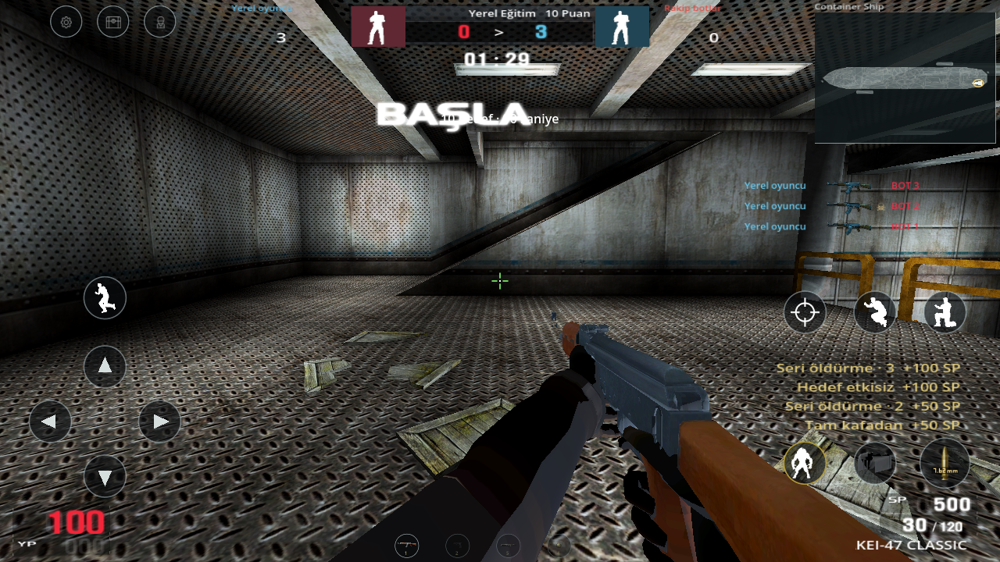
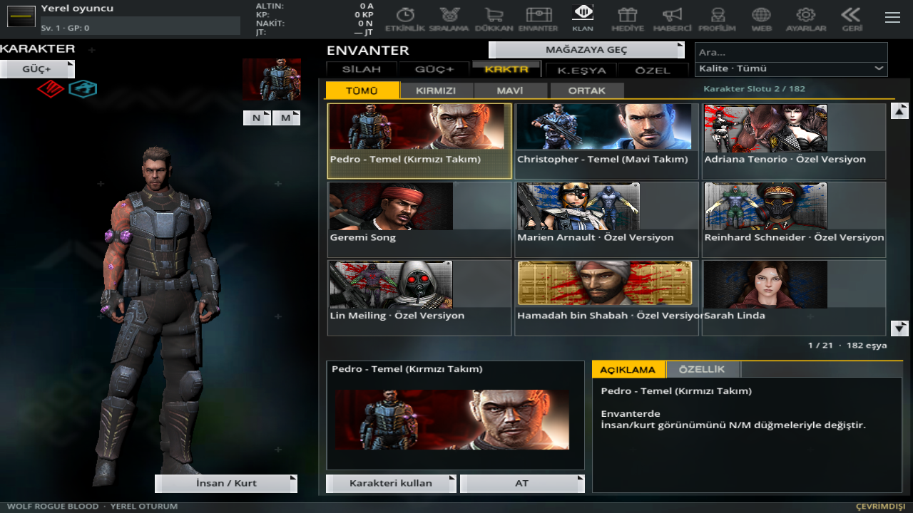
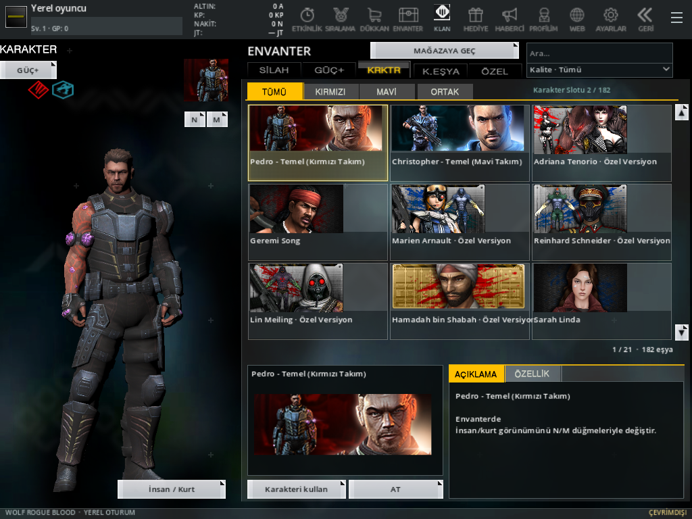

# 0.14 — İnsan HUD ve karakter envanteri

12497 ve 12499 numaralı PC ekranları ile önceki referanslar yeniden karşılaştırıldı. İnsan HUD'unda üst skor alanı artık takımın gerçek öldürme/ölüm sayılarını gösterir; 10 puanlık yerel hedef başlıkta ayrıca yer alır. Sağdaki ölüm akışı takım renkli isim, gerçek kullanılan silah görseli, kafadan isabet işareti ve beş satırlık süreli liste kullanır. Oyuncunun bot tarafından öldürülmesi de aynı listeye girer. Görüntülerdeki bot olayları kontrollü test verisidir.

Karakter envanterinde seçilen kaynak kartın geniş görseli, tam boy modele ayrılmış sol alan, küçük karakter kartı, N/M insan-kurt düğmeleri, slot sayacı, alt kullan/at düğmeleri ve STATS paneli eklendi. Özgün 2D kartı eşleşen karakterler o kartı kullanır; diğerlerinde aynı karakterin gerçek model önizlemesi ve yüz yakınlaştırması kullanılır. Başka karakterin kartı atanmaz. Sol panel yalnızca uygulanan yerel can, hız, güç ve GP çanta bonusunu gösterir; doğrulanmayan PC bonusları uydurulmaz. AT düğmesi, kalıcı çevrimdışı kaynak koleksiyonunun silinmediğini açıklar; PC süreli envanter silme servisi değildir.

19 harita, mevcut kaynak modeller, önceki ekipman/hediye akışı ve yuvarlak mobil eylem düğmeleri korunur. Kaynak ekranlardaki 240 YP, 160 puan, SP ekonomisi, bütün karakter kartları/bonusları ve silahsız karakter menü animasyonunun birebir uygulandığı iddia edilmez. Model hâlen kaynak idle animasyonunu kullanır. Tam PC görsel eşitliği ve fiziksel telefon testi doğrulanmadı; gerçek sunucu yoktur.

18 regresyon aşaması, 12 yeni HUD/envanter kontrolü ve önceki 191 ekipman/model kontrolü çalıştırılır. Toplam 80 gerçek OpenGL ekranı güncel kodla yeniden üretilir. APK ayrıca katalog, kaynak bağımlılığı, ZIP, imza, kimlik ve izin açısından doğrulanır.

[Regresyon](mobile-validation.json) · [Yeni kontroller](human-reference-validation.json) · [Yeni görüntüler](human-visual-validation.json) · [Önceki referanslar](PC_REFERANS_013.md)
