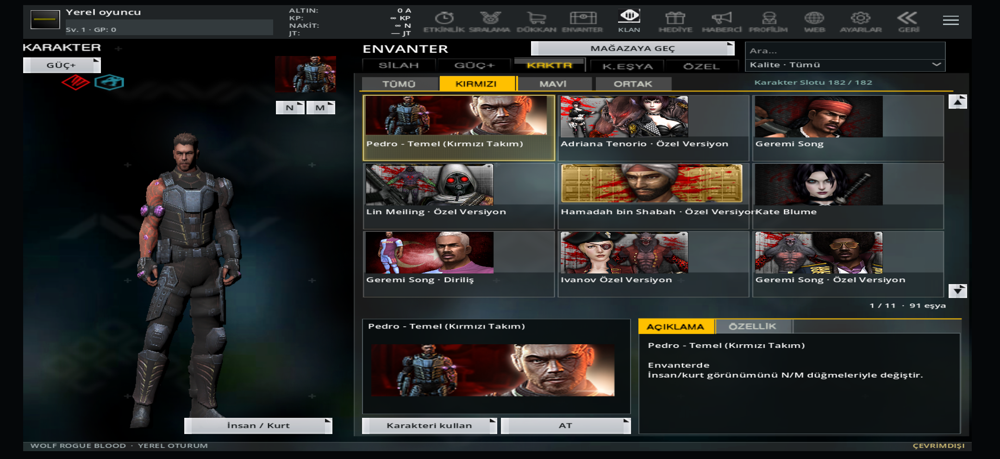
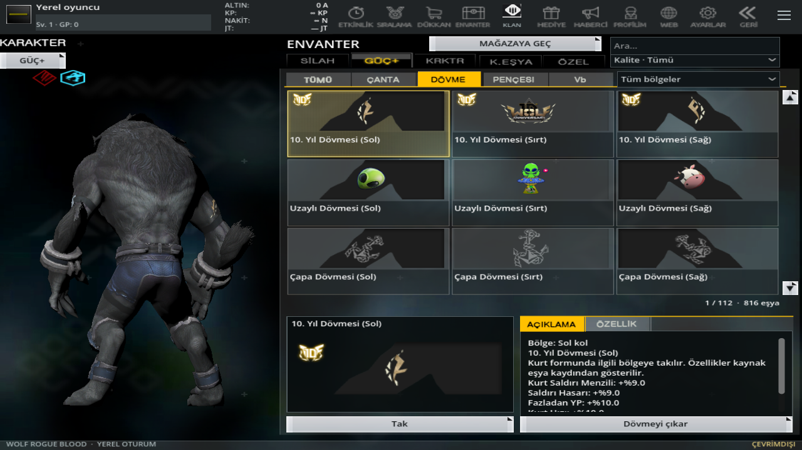
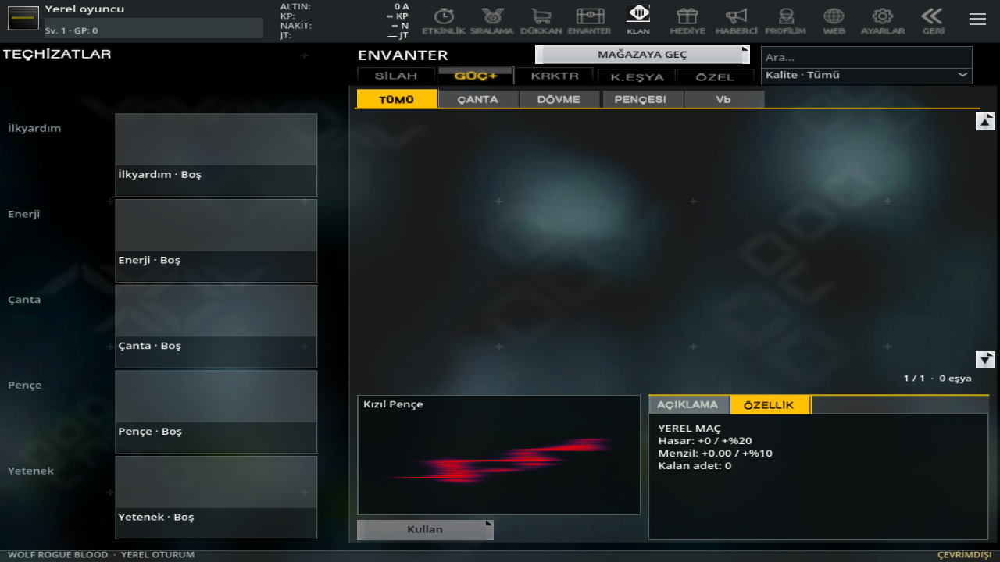

# 0.15: takım modelleri, dövme/pençe ve mobil kontroller

0.14'ün 48 kullanılabilir insan/kurt çiftine **134 kaynak çift** eklendi: **182 kullanılabilir çift, 91 kırmızı / 91 mavi**. Her iki görünüm kendi kaynak modelini ve dokularını kullanır. Takım seçimi yeniden renklendirme değildir. Kırmızı ve mavi ekipman seçimi ayrı kaydedilir; maç içindeyken diğer takımın karakterini seçmek çalışan oyuncu modelini bozmaz. Dört önceki dışlanmış model dışlanmış olarak kalır.

Yeni çiftlerin iki biçimi de gerçek OpenGL ile çizildi. Kaynak animasyonların üç örnek zamanında bütün kemik dönüşümleri sonlu olmalıdır. [134 çiftin kabul raporu](character-admission-015.json), [kaynak eşleştirme ve alınamayan modeller](character-expansion-015.json). Kaynakta duvara tutunma gibi bir klip bulunmuyorsa başka animasyonla ikame edilmez.

## Arayüz ve dokunma

- Telefonun güvenli alanı menü tuvalini sınırlar. Önizleme kamerası oynatılan iskeletin sınırlarını kullanır. 1280×720, 2160×992 ve 2400×1080 oranları, benzetilen çentik paylarıyla kontrol edilir; fiziksel Android testi değildir.
- Silah, karakter, dövme ve pençe ızgaraları parmakla yukarı/aşağı kaydırılır. Sürükleme eşya seçmez; kısa dokunma seçim yapar. Kaydırma sırasında dört satırlık tampon, görünür üç satır içinde kırpılır.
- **Sol kol / sırt-gövde / sağ kol** setleri aynı satırda gösterilir. Eksik set yuvaları gerçek eşya gibi gösterilmez. Aynı adlı farklı kayıtlar korunur; 819 dövmenin hiçbiri set gruplamasında kaybolmaz.
- Kaynak adında açıkça geçen **Efsane, Elit, EX, Altın, Gümüş, Standart** etiketleri filtrelenir ve kart zeminiyle gösterilir. Diğerleri "Diğer" kalır. Bu, çözümlenmiş sayısal PC kalite tablosu değildir.
- Ateş düğmesini tutarken aynı parmağı sürüklemek insan kamerasını döndürür. Diğer hareket/nişan parmaklarının sahipliği korunur.
- Yön verilmeden takla atmak otomatik ileri hız üretmez. Kükreme sırasında yürüme durur; alakasız mor halka çizilmez. Gerçek karakter `T_CRY` klibi kullanılır.

## Dövme ve pençe kaynak verisi

`character&tattoo.dat`: **2.808 kayıt**, 17 bayt/kayıt. Türler 51 sırt, 52 sol, 53 sağ kol, 54 pençe. Tür/kimlik ailesi, mevcut açık bölge adlarıyla çapraz kontrol edilir. İki çelişkili kaynak tür kaydı ayrıca saklanır.

Hasar/menzil sütunları, on ayrı pençenin açık kaynak açıklamasıyla doğrulanır. **11 kaynak pençe** yerel koleksiyona açıldı; kendi oranları ve `abilityswingtrail.dat` içindeki doku/dört el kemiği bağları kullanılır. Örneğin Kızıl +%20 hasar/+%10 menzil, Gölge %0 hasar/+%10 menzildir. İki el için ayrı iz çizilir.

Dövme gücü resme göre değil **eşya kimliğine** göre saklanır. Aynı resmi paylaşan farklı eşyalar karışmaz. Yalnızca doğrulanmış hasar/menzil ve kaynak açıklamasında açık yüzdeyle belirtilen YP, hız, GP, altın değerleri uygulanır. `255` özel hasar kodu çözümlenmediğinden %255 olarak uygulanmaz. Diğer sütunlar, koşullu beceriler ve özgün yığılma kuralları henüz çözümlenmedi; yerel toplama kuralı PC eşdeğerliği diye sunulmaz. YP artıran eşyayı takmak can doldurmaz; çıkarınca mevcut can yeni üst sınırı aşmaz.

[Alanlar, kanıtlar ve uygulanmış değerler](item-source-facts-015.json). Kaynak arşivde OG/09 dövmesinin doğrulanabilir eşleşmesi ve varsayılan `swingTrail_default.dtx` bulunamadı; yerine başka eşya çizilmez. Tüm karaktere özgü kükreme parçacıkları/sesleri tamamlanmış değildir.

## Haritalar ve botlar

Önceki 19 harita korunur, tohum `20261105` ile **15 farklı kaynak harita** eklenir: Cqc Zone, Rose, Station, Battle Zone2, Junk Field, Storage, Bridge, Train Factory, Break-Out, Cage, Purge, Explosive Arsenal, Machu Picchu, Paien Lab ADV, UnderWorld. Giriş/İki Tapınak eklenmez. [Seçim ve kaynak raporu](map-expansion-015.json).

34 geometri, kaynak doğma noktaları, ayakta kapsül boşluğu ve bağımsız yürüyüş ağları kontrol edilir. Oyuncu ve botlar kendi takımının kaynak doğma grubunu kullanır. Yerel eşleme Team1=kırmızı, Team0=mavidir. #46/#110'da bir takım etiketi eksik olduğundan o taraf ayrı **NoTeam** grubuna bağlanır; özgün kaynak etiketi değiştirilmez. Erişilebilir takım noktaları önceliklidir; oyuncu dibinde veya başka botla iç içe doğuş engellenir.

Botlar dar geçişte çömelir ve uygun basamakta sıçrar. İlave kısa atlayışlar iki yönde kapsül süpürmesi ve gerçek `CharacterBody3D` inişiyle kabul edilir; ışınlanma/çarpışmayı kapatma yoktur. [Atlayış kabulü](bot-traversal-validation-015.json). [34 haritanın iki takım kontrolü ve maç raporu](offline-match-validation.json).

**#72 Ruins, #37 Bridge, #106 UnderWorld** için kaynak takım alanları arasında bütün yollar henüz bağlı değildir. Botlar kendi erişilebilir alanlarında devriye gezer; bütün koridorlarda oyuncuya ulaşabiliyor diye işaretlenmez. Hareketli dünya parçaları/özgün BSP fiziği, render üçgenlerinden üretilen çarpışmayla tamamen eşdeğer değildir.

Önceki 19 haritanın PC fotoğrafları korunur. Yeni 15 seçim görseli **gerçek dönüştürülmüş geometriden render** edilir; özgün PC menü fotoğrafı diye etiketlenmez. Yeni haritalardaki alınamayan sesler de [ses raporunda](map-audio-validation-015.json) açıkça listelenir; başka sesle doldurulmaz.

## Görüntüler ve doğrulama

[10 yeni ekran](update-015-visual-validation.json), önceki dört görsel akışın 80 güncel görüntüsüyle birlikte kod özeti ve PNG SHA-256'larına bağlanır. Ayrıca 268 yeni model görüntüsü vardır. [Mobil kontrollerin/kalıcılığın yeni kontrolleri](mobile-015-validation.json), [tam mobil regresyon](mobile-validation.json).

Kullanıcının son dört YouTube bağlantısı ağ vekili CONNECT 403 nedeniyle açılamadı. İzlenmiş sayılmaz. Son arşiv istekleri HTTP 503 verdiğinden 122 ek model tanımı bu güncellemede alınamadı. Mevcut dosyalar ve sağlanan fotoğraflar üzerinden çalışıldı. Tam PC görsel/mekanik eşitliği ve fiziksel telefon testi doğrulanmış değildir.

APK boyutu için orijinal PNG/WAV dosyaları korunur; Android'in kullandığı render kopyalarında WebP kalite 0.95 ve QOA ses uygulanır. UI simgeleri kayıpsızdır. [Tekrarlanabilir içe aktarma profili](../godot/assets/mobile-import-profile.json).
