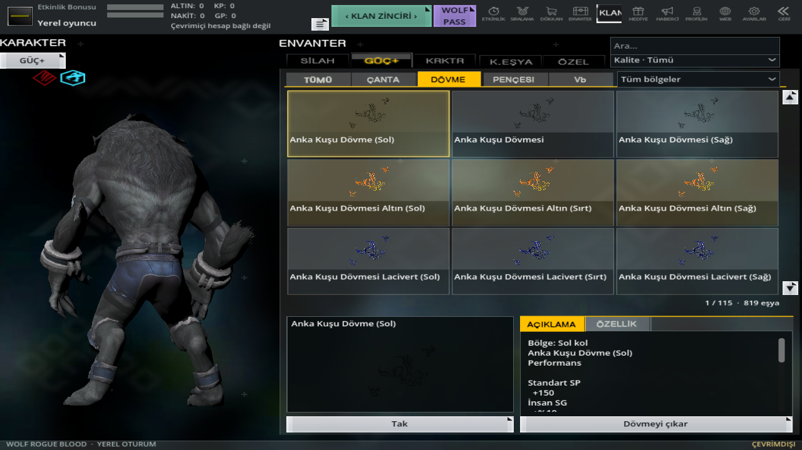
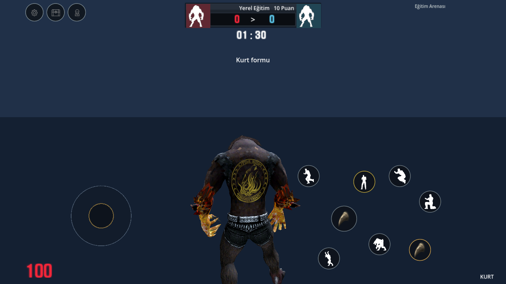
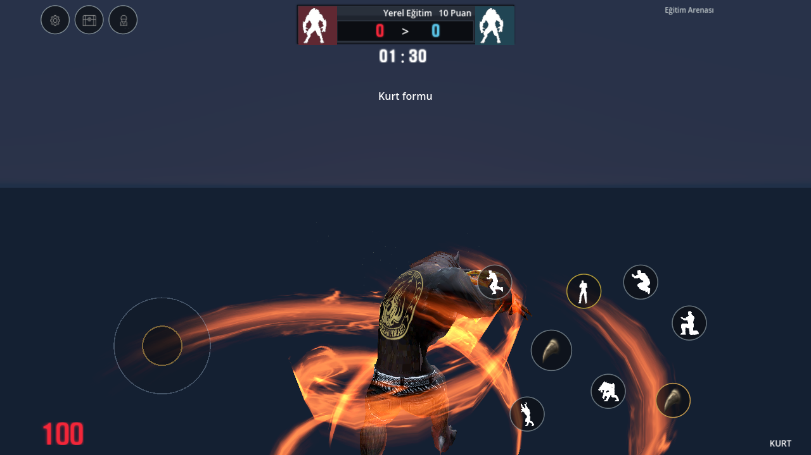
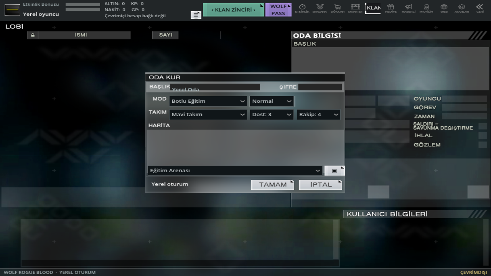
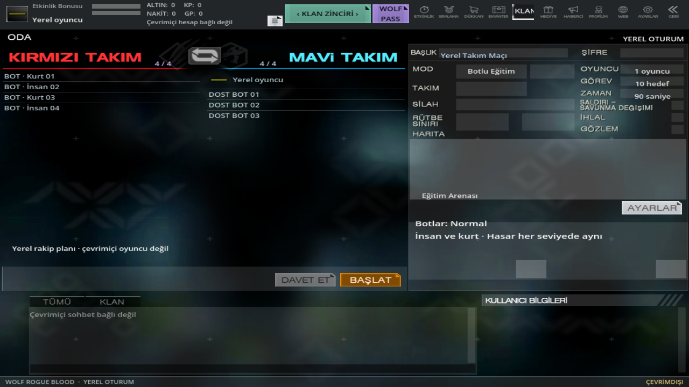

# 0.16: envanter, takım botları ve kükreme/takla düzeltmeleri

Karakter ve dövme önizlemesindeki ayrı koyu dikdörtgen kaldırıldı. 3B görünüm sayfanın özgün sisli arka planına saydam olarak çizilir. Eklenmiş STATS paneli ve alttaki üç dövme ekipman kartı kaldırıldı. Kurt, sol sütunun büyük bölümünü kaplar; kamera animasyondaki iskelete göre ortografik kadraj kurar. Küçük kırmızı elmas ve mavi altıgen, PC `iv_ch_tab.dtx` atlasının gerçek normal/vurgu/seçili karelerinden alınır. Serbest döndürme, takım başına ayrı kaynak karakterleri, N/M, kaydırma ve kalite filtreleri korunur.

## Son üç video ve kaynak efektleri

Kullanıcının son üç TikTok bağlantısı indirildi ve görüntü örnekleri incelendi:

- `ZSp2tTbNe` → `7649387493690756360`, 76 saniye, kurt oynanışı/efektler.
- `ZSp2GNUdF` → `7667260348008828181`, 48 saniye, kutu açılışı/envanter.
- `ZSp2tk97Y` → `7110293555163270402`, 17 saniye, takla/kükreme.

Bu erişim, önceki dört YouTube bağlantısının izlendiği anlamına gelmez. O bağlantılardaki ağ engeli hakkında 0.15 kaydı korunur. Kutu görüntüsündeki PC ızgarası mevcut kutu akışıyla karşılaştırıldı; bu sürümde yeni bir çevrimiçi kutu veya ödül kuralı icat edilmedi.

Özgün RAR'dan bu kez `ClientFX.fxf` alınabildi. CP1254 kaynak metni ve ModelButes, yeniden üretim için sıkıştırılmış olarak [ClientFX](pc-clientfx.fxf.gz) / [ModelButes](pc-modelbutes.txt.gz) içinde korunur. [İçe aktarıcı](../tools/import_roar_fx_016.py), modelleri/sprite DTX'lerini CRC ve SHA doğrulayan kaynak önbelleğinden alır.

Kaynak `ClientFXOnce` bağlarıyla **52 karakter**; kırmızı/mavi Reboot, ateş, buz, radyasyon ve yıldırım `Howling` gruplarına bağlandı. Yedinci Wraith grubu çözümlendi fakat kullanılabilir karakterde doğrulanmış bağ bulunmadığından otomatik atanmadı. [Efekt kataloğu](../godot/assets/abilities/source-roars.json) özgün başlangıç/bitiş, renk/ölçek anahtarları ve kaynak resim/model özetlerini saklar. 26 doku dönüştürüldü; içe aktarma hatası yoktur.

**Bu, PC efekt motorunun tam aktarımı değildir.** Parçacık miktarı/hızı/ışık mobil sınırlarla uyarlanır; bütün modellerde `cry` soketi bulunmadığında açıkça belirtilmiş boyun yüksekliği kullanılır. Karaktere özel tüm sesler ve bütün etki kuralları tamamlanmadı. Bağı olmayan karakterlere rastgele efekt verilmez. Önceki alakasız genel mor halka kapalı kalır.

Kükremede dövmenin kendi renk dokusu korunur; beyazlaşmaya neden olan 4.0 emisyon çarpanı en fazla 0.45'e düşürüldü. Kaynak efekt ışığı da sınırlandırıldı. Duraklatma, biçim değiştirme ve maç bitişi parçaları temizler.

Takla hareketi animasyon uzunluğundan ayrıldı. Yönlü taklanın toplam yatay yolu en fazla **3 metre**; 0,4/0,8/1,2 saniyelik klip süreleriyle fiziksel konum ölçüldü. Yön verilmezse takla ileri hız üretmez. Bitişte kalan yatay hız sıfırlanır. 3 metre kullanıcının örneğinden seçilen mobil ayardır; özgün PC dosyasından çözülmüş kesin mesafe değildir.

## İki takımda bot

Oda oluştururken **Dost: 0–4 / Rakip: 0–4** bağımsız seçilir. Kendi takım botları gerçek karakter gövdeleridir; rakip oyuncu/botları hedefler. Dost ateşi hasar vermez; takım arkadaşları fiziksel mermiyi engelleyebilir. Kaynak kırmızı/mavi doğma grupları korunur ve üst üste doğuş engellenir.

Botun başka botu yenmesi takım skorunu ve ölüm duyurusunu günceller; oyuncuya kişisel öldürme, isabet veya para yazmaz. Skor tablosu iki gerçek takım sütunu kullanır. Dost botlu normal yerel maçta oyuncu ölünce botlar savaşmaya devam eder; oyuncu üç saniye sonra kendi takım noktasına döner. On takım puanı maçı bitirir. Solo eğitim ve yerel Kurt Avı'nın önceki ölüm/raunt davranışı korunur. Bunlar yerel kurallardır, PC sunucu kodu olarak sunulmaz.

Kolay/Normal/Zor, eşit 8 taban isabet hasarı ve sonlu şarjör/mühimmat korunur. 80/95/110 değerleri oyun karar profilleridir, insan IQ ölçümü değildir.

## Haritalar ve doğrulamanın sınırı

34 harita korunur. Üç sorunlu haritanın kaynak DAT geometrisi ve ek yüzeyleri yeniden incelendi. Kısa atlayış adayları süpürülmüş kapsülle üretildi; ardından gerçek `CharacterBody3D` kalkış/iniş deneyinde başarısız olan 82 aday çıkarıldı. **78 kabul edilmiş bağlantı** kaldı. Tek yönlü bağlantıda yalnızca doğrulanmış yön açılır; geri dönüş yolu varsayılmaz. Işınlanma, görünmez zemin veya çarpışmayı kapatma kullanılmaz.

**#72 Ruins, #37 Bridge ve #106 UnderWorld'ün bütün takım alanları hâlâ birbirine bağlı değildir.** Daha fazla yerel geçiş fiziksel olarak doğrulandı, ancak üç haritanın bot rotaları tamamen düzeldi diye işaretlenmedi. Özgün hareketli dünya parçaları/BSP etkileşimleri eksiktir.

[31 yeni işlev kontrolü](mobile-016-validation.json), [bütün mobil regresyon](mobile-validation.json), [34 harita ve takım doğuş kontrolleri](offline-match-validation.json), [fiziksel atlayışlar](bot-traversal-validation-015.json), [yeni gerçek OpenGL görüntüleri](update-016-visual-validation.json). Bütün ekranlar test çalıştırmasından alınır; fiziksel Android cihaz testi değildir. Kaynak karakter/eşya sayıları ve çözümlenmemiş güç alanları için [önceki kaynak kapsamı](PC_REFERANS_015.md) geçerlidir. Tam PC eşitliği veya hatasızlık garantisi verilmez.
