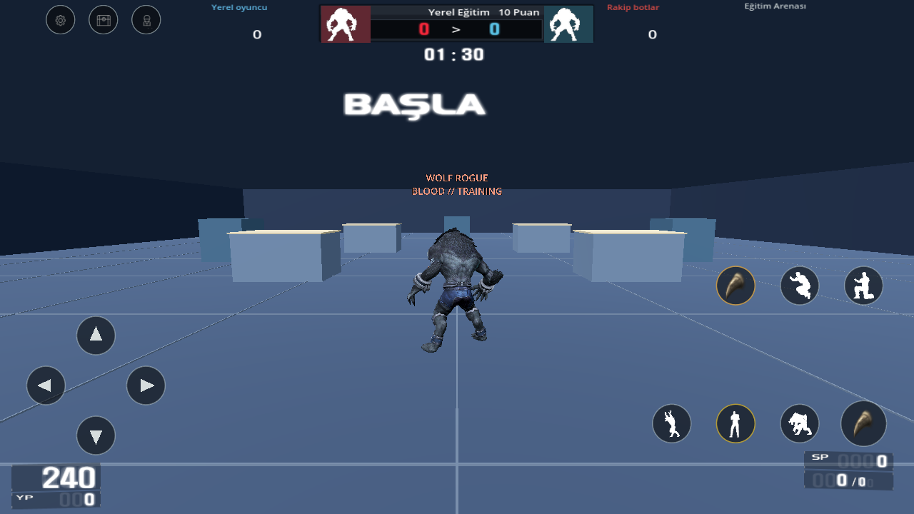
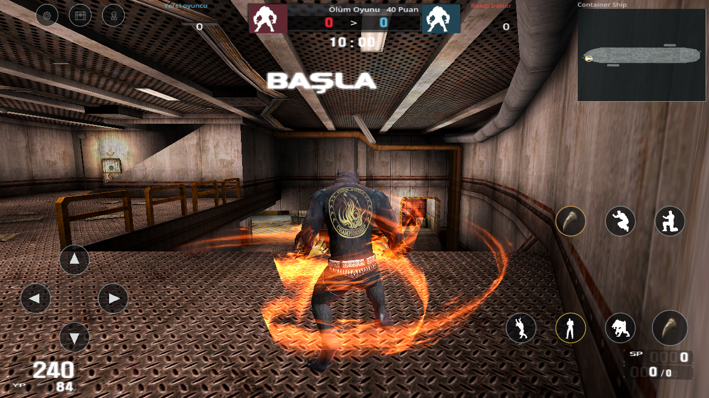
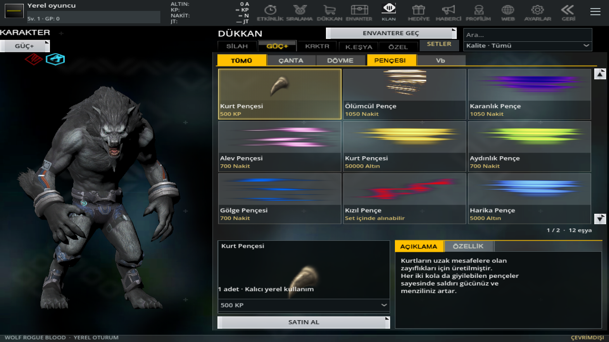
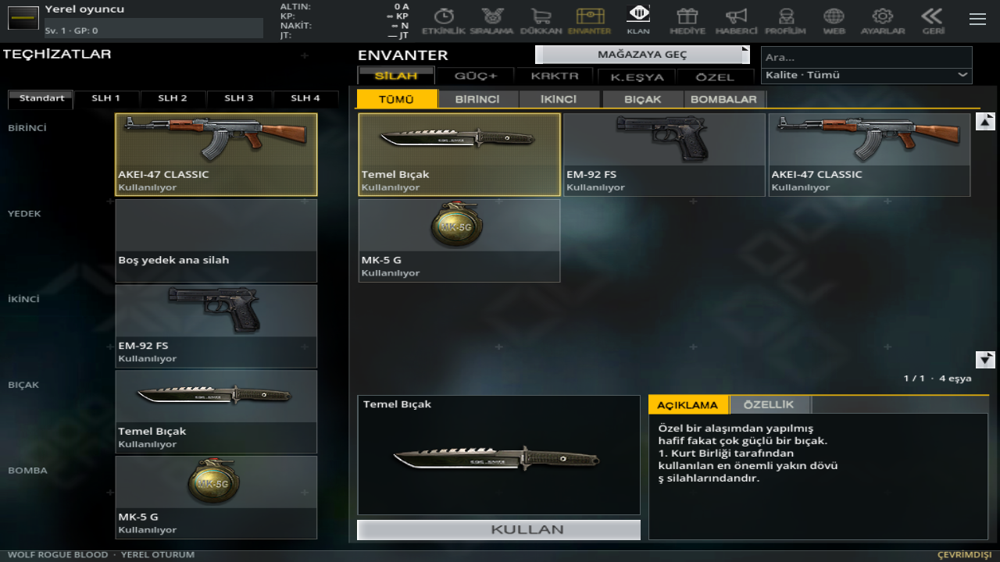
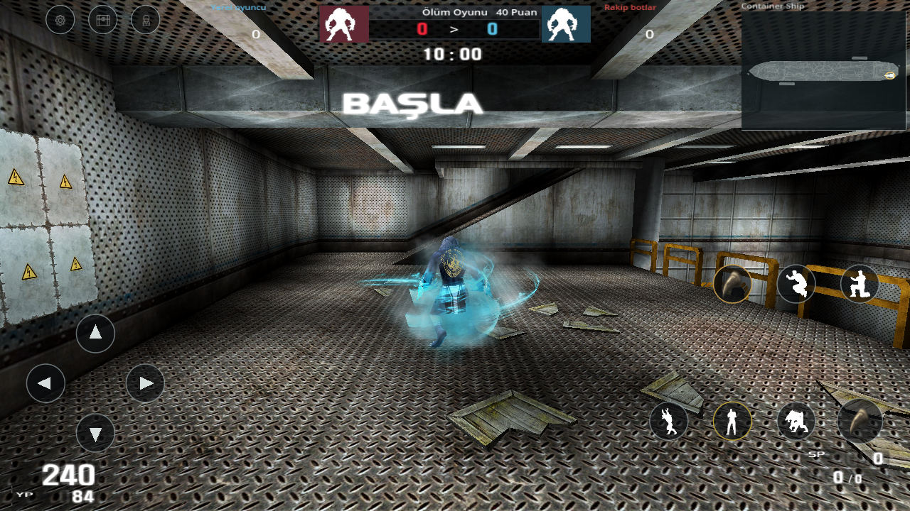
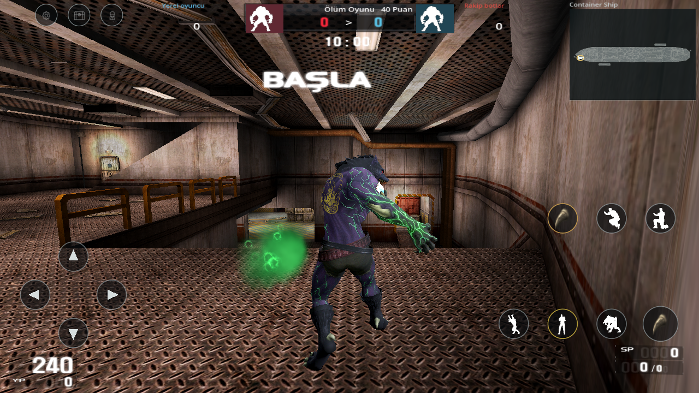
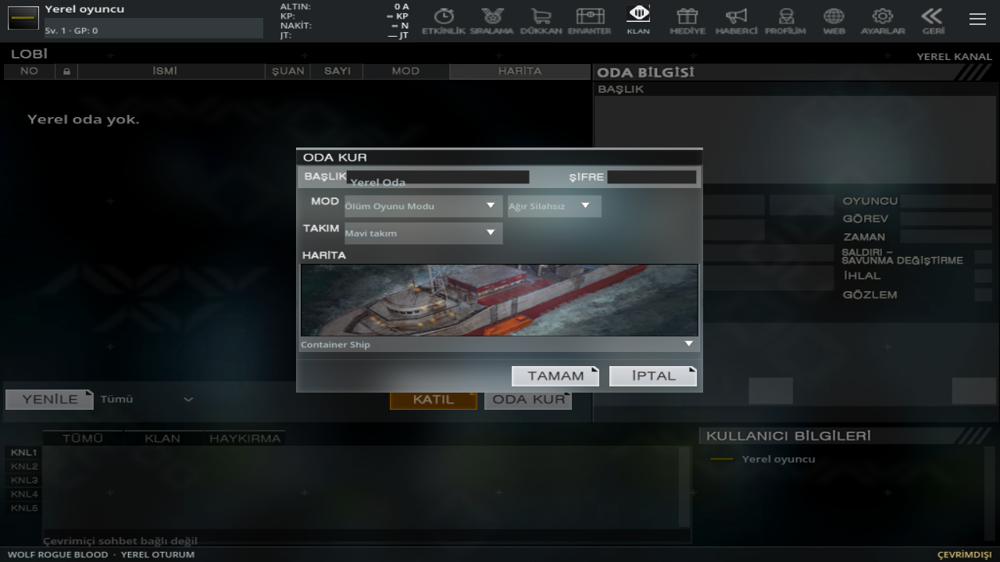
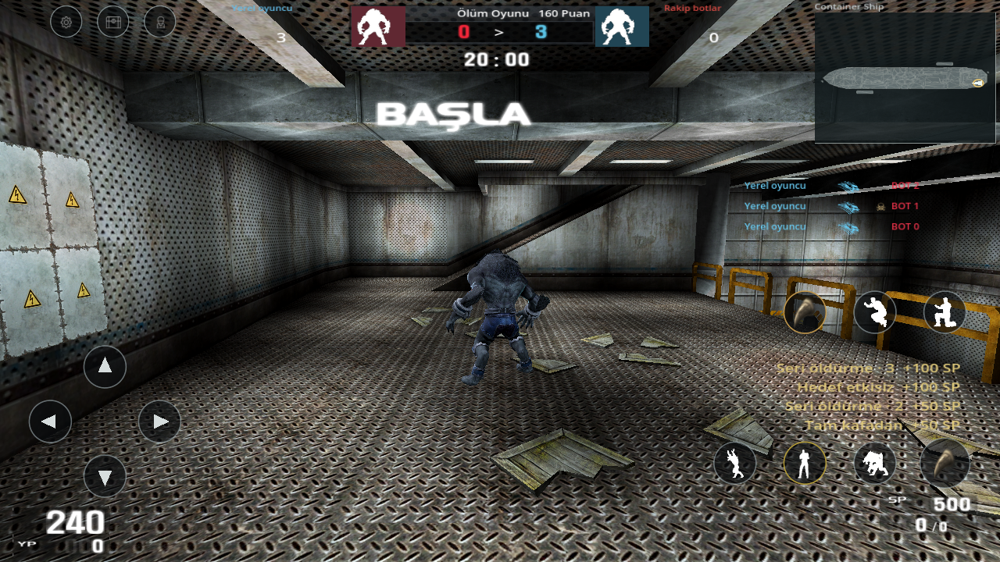

# 0.17: yön düğmeleri, gerçek sahiplik, mağaza ve kaynak efektleri

0.16'da bulunmasına rağmen oyun olaylarına bağlanmamış kaynak veriler ele alındı. Bu sürüm bütün PC oyununun tamamlandığı anlamına gelmez; aşağıda çalışan bağlar ile kalan kaynak/mekanik eksikleri ayrı belirtilir.

## Son video, kontroller ve envanter

[Son TikTok incelemesi](video-shop-controls-017.json): 77 saniyelik video indirildi; menü, mağaza ve oynanış kareleri boyunca örneklenerek incelendi. Videodaki değiştirilmiş ücretsiz mağaza, özgün PC arşivindeki fiyat tablosuyla aynı değil. Dört YouTube erişim engeli devam ediyor.

- Varsayılan joystick yerine yuvarlak ileri, geri, sol ve sağ düğmeleri gelir. Eski çevrimdışı ayar bir kez bu düzene geçirilir; daha sonra kullanıcının açıkça seçtiği kontrol tercihi korunur.
- Özel Kurt Yeteneği takılınca kaynak kurt/ok resmiyle **KURT KOŞ** düğmesi görünür. Düğme koşuyu hazırlar; ileriye basıldığında dört ayak koşusu başlar. İleriye iki kez basma da kaynak 19601 kuralıyla aynı koşuyu başlatır. Yeteneği çıkarınca düğme ve koşu kapanır. Düğme tek başına kurdu ileri sürüklemez.
- Kükreme soketi konumu ile efekt yönü ayrıldı. `ParentAlign` model yönü, boyun kemiği yerine karakterin yönünü kullanır; düşey kaynak ofseti yana kaymaz. İç içe el/uçuş efektinin sabit koordinatı kendi hareketli referansında tutulur; geride kalan bulut düzeltilir. Bu, tüm kaynak shader/koordinat türlerinin PC ile piksel eşitliğinin kanıtı değildir.

Çevrimdışı APK artık bütün kataloğu otomatik açmaz. Yeni profil **bir tüfek, tabanca, bıçak ve bomba; her takım için bir varsayılan karakter; her dövme bölgesinden bir eşya; beş güç yuvasının her birine bir başlangıç eşyası** alır. Güç eşyaları birer adettir ve otomatik takılmaz. Bu başlangıç paketi açık bir yerel uyarlamadır; PC sunucusu başlangıç ödülü diye sunulmaz. Kullanıcının açık tercihiyle **Nakit ve KP sınırsızdır (∞)**; satın alma bu iki bakiyeyi tüketmez. Altın ve GP sınırlı kalır; önceki ilerleme ve kabul edilmiş hediyeler korunur. Sınırsız para envanteri otomatik açmaz.

Mağazada tüm içe aktarılmış silah, karakter, dövme ve güç/pençe kayıtları kategori, kalite ve aramayla gezilir. Envanter yalnızca sahip olunanları gösterir. Eski otomatik açılmış silahlar, başlangıç eşyaları ve hediye defterinde onaylanmış satın alımlara geçirilir; doğrulanmış alımlar silinmez. Önceden açılmış kutuların doğrulanmış ödül geçmişi de kalıcı sahipliğe geçirilir; yeni kutu ödülü açılışla aynı atomik işlemde kaydedilir. Önceden kaydedilmiş fakat artık sahip olunmayan seçimler ve ekipman yuvaları kullanılabilir varsayılana döner. Satın alınmamış karakter/dövme/silah, arayüz dışından da takılamaz.

`shopdata.dat` **4.934 × 359 baytlık kayıt** olarak çözümlendi. [Özgün tablo ve kanıt](shop-source-017.json.gz), [yeniden üretim aracı](../tools/import_shop_017.py). İçeri aktarılmış **1.926 eşya kimliğinin 1.414'ünde** özgün fiyat sütunuyla eşleşme bulunur. Altın/Nakit/KP seçeneği, tablodaki ilk pozitif fiyatı kullanır; **512 kimlikte fiyat doğrulanamadı**, ücretsiz kabul edilmez ve satın alma açılmaz. Eşleşen karakter kimlikleri aynı `characterdata.dat` model/eşya bağından alınır; ad benzerliğiyle fiyat tahmin edilmez.

**Yerel alışveriş bir adet kalıcı kullanım verir.** Özgün süre, paket adedi, kampanya ve indirim alanlarının hepsi çözümlenmedi. Bu nedenle sayısal kaynak fiyatı kullanılması, PC'nin süreli/paket satış davranışının tamamlandığı anlamına gelmez. Satın alma bu uyarlamayı onay ekranında açıkça gösterir. İade/silme ve oyuncular arası gönderim eklenmedi.

Satın alma, bakiye düşümü ve bekleyen hediye tek atomik dosyada saklanır. Aynı işlem kimliği ikinci kez ücret kesmez. Eşya ancak hediye kutusunda **Al** ile onaylanınca envantere geçer. Tekrar onay, yetersiz bakiye, bilinmeyen eşya/para birimi, dolu kutu ve başarısız kayıt para/eşya çoğaltmaz. [61 sahiplik, alışveriş, geçiş ve kontrol denetimi](shop-controls-017-validation.json).

## Efekt ve animasyon bağlantıları

Özgün `ClientFX.fxf` dosyasındaki **628 grup / 11 düğüm türü** çözümlendi. Sprite, parçacık, ışık, flare, LTB model, ses, kamera sarsıntısı, alt efekt, yıldırım, çokgen iz ve sprite sistemi için mobil çizim karşılıkları bulunur. **95 kaynak efekt modeli** dönüştürüldü. Kütüphanedeki mevcut sprite kareleri ve dokular yeniden kullanılır; başka bir eşyanın görüntüsüyle ikame yapılmaz.

ModelButes içindeki `Fireball_SE`, `Iceball_SE`, `Lightningball_SE`, `Radiationball_SE` adları ClientFX grubu değildi. `attributes/fx.txt` içindeki dört gerçek `ProjectileFX` tanımı bulundu; kendi model/skin ve uçuş efekti adlarıyla el efekti olarak bağlandı. Katalog bu dört tanımla **632 kayıt** içerir. Bu görsel bağ, enerji topunun özgün sunucu hasarı/özel durumlarının bütünüyle simüle edildiği anlamına gelmez.

**182 insan/kurt çiftinin 34 ayrı efekt adı** artık bulunmuş tanımlara bağlanır; bu bağlı tanımların gereken görsel düğümlerinde eksik kaynak yoktur. Kaynak animasyonların **29 gerçek donöründeki** olay dizeleri ve soketler korundu. `show_attachfx`, `hide_attachfx`, `create_attachfx`, `FX`, `WolfCrySnd`, çift parametreli `sound_key`, `FOOTSTEP_KEY` ve pençe `spline` pencereleri işlenir. Sabit bir anda bütün efektleri oynatmak yerine gerçek kare zamanları kullanılır. Örneğin SE ateş kükremesinin efekti 0,933 saniyedeki kaynak tetikle başlar.

Güçlü yer pençesi, **24 donörde bulunan gerçek `UMFi3`** izlerinden ayrı animasyon verisiyle yüklenir. Önceden kabul edilmiş karakter GLB dosyaları değiştirilmedi. Kaynakta bu klip yoksa başka pozla doldurulmaz. Yerdeki güçlü pençe, havadaki saldırıdan ayrıdır; hasar ilgili kaynak `FIRE_KEY` anında mevcut yerel dengeyle uygulanır. Pençe şeritlerinin hangi elde ve hangi zaman aralığında görüneceği animasyonun `spline` tetiklerini izler.

Kükreme dokusunun rengi ve 3 metrelik takla sınırı korunur. LTB efektlerinin `ADDITIVE.LTB` çizim biçimi uygulanır; siyah doku dikdörtgeni çizilmez. Efektler duraklatma, biçim/model değişimi ve maç geçişinde temizlenir. Mobil sınırlar: en fazla 64 etkin grup, parça başına 128 parçacık, sınırlı ışık/sarsıntı, en fazla üç alt efekt seviyesi. Bunlar PC efekt motorunun bütün shader/çarpışma/LOD davranışlarının birebir kopyası değildir.

## Sesler

`humansound.dat` ve `wolfsound.dat` tamamen okundu: **791 model/olay eşleştirmesi**, ortak kullanılan **134 mevcut WAV**. Eşleştirmelerde eksik ses yoktur; bu sayı 791 farklı ses dosyası demek değildir. Paketteki toplam 1.550 sesin kaynak kökeni korunur.

Karakter/model kimliğine göre ölüm, iniş, kurt kükremesi ve tanımlı kurt sıçrama sesleri bağlanır; mutasyon modeli kendi kaynak ses kaydını kullanır. Animasyonlardaki çift parametreli doğal silah `sound_key` çağrıları kaynak `weapondata.dat` kayıtlarıyla eşlenir. Ayak sesleri kaynak animasyon adımlarında çalınır; yüzey adı tanınmazsa çimento sesi açık bir mobil uyarlamadır. İnsan şok sesleri ve tek parametreli bazı eski olay dizelerinin bütün özgün koşulları çözümlenmiş sayılmaz.

Dönüşüm, hasar, ilk öldürme, kafa vuruşu, son dakika, maç başlangıcı ve kırmızı/mavi galibiyet veya beraberlik sesleri kendi oyun olaylarına bağlandı. Ses havuzu sınırlıdır; ses ayarları, arka plan/duraklatma ve sahne temizliği korunur. Test çalıştırması fiziksel hoparlör/telefon dinleme testi değildir.

## Kaynak Ölüm Oyunu kuralları

Önceden yalnızca katalogda bulunan şu beş kaynak mod, kendi bağlı haritalarında çevrimdışı çalışır:

| Kaynak kimliği | Biçim |
| --- | --- |
| 1000 | Normal Ölüm Oyunu, ağır silah kısıtlı |
| 1001 | Normal Ölüm Oyunu |
| 1010 | Kurt vs Kurt |
| 1020 | İnsan vs İnsan, ağır silah kısıtlı |
| 1021 | İnsan vs İnsan |

`modemission.dat` puan seçenekleri **40/60/80/100/120/140/160**; `modetime.dat` süre seçenekleri **10/20/30/40 dakika**. Varsayılan **100 puan / 10 dakika** doğrudan tablo bayraklarından seçilir. Bilinmeyen seçenekler bu gerçek varsayılana döner. Oda ve HUD bu değerleri gösterir; eğitim modunun 10 hedef/90 saniyesi bu modlara taşınmaz.

İnsan/kurt biçim kısıtları hem oyuncuya hem botlara uygulanır. Ölüm Oyunu oyuncusu dost bot seçilmese de yeniden doğar; skor sıfırlanmaz. Takım puanı hedefe ulaştığında veya süre bitince gerçek skorla kazanan belirlenir; eşitlik beraberliktir. Kaybeden veya berabere kalan taraf galibiyet rozeti almaz. Maçlar yereldir, çevrimiçi oyuncu veya sunucu sonucu üretilmez. Üç saniyelik yeniden doğuş, bot sayısı ve hasar/hız değerleri hâlâ mobil denge ayarlarıdır. Ağır silah kısıtı kategori düzeyindedir; bütün kaynak bit maskeleri çözümlenmiş değildir.

## Harita nesneleri ve kalan eksikler

34 haritadaki **96 SpecialFX / 233 ScaleSprite** kaydı incelenir; başlangıç ve döngü bayraklarına göre kaynak konumlarında çalıştırılır. Kaynak ömrü, sprite renk/ölçeği, billboard ve toplamsal çizim bilgileri kullanılır. Uzun ömürlü harita parçacıkları hazırlanır; görünürlük sınırı yayılma alanını kapsar. İki `<none>` kaydı efekt diye üretilmez. Bir ScaleSprite kaynağı (`01_topkapisarayi_lightglow_yellow.spr`) bulunamadı; yerine başka ışık resmi konmaz. Bazı dünya gruplarındaki eksik kaynak düğümleri aşağıdaki raporda korunur.

[Efekt içe aktarma raporu](clientfx-import-017.json): 628 özgün + 4 yerel bağlanan native tanımın **549'u bütün düğümleriyle mevcut**, 83'ünde toplam **158 eksik/desteklenmeyen kaynak düğümü** bulunur. Bunların önemli bölümü eski NOLF/test içerikleridir; haritadaki kısmen eksik tanımlar da gizlenmez. Bu yüzden “arşivdeki her efekt eksiksiz tamamlandı” denmez. Başka dosyanın rengi/sesiyle doldurulmaz.

İşgal, Yıkım, Ice Hold/Uyku, Kurt Avı'nın özgün varyantları, Wolf Rush ve diğer katalog modlarının bütün maç kuralları tamamlanmadı. Önceki yerel Kurt Avı/öğretici korunur. Üç haritanın (#72/#37/#106) bütün takım alanları arası bot yolları hâlâ bağlı değildir. Koşullu eşya güçleri, bütün karakter/GUI efekt koşulları, hareketli dünya parçaları ve bazı özel ses tetikleri bekler. Eğitim arenasında kırmızı doğuşun bir sütunun içinde kalması düzeltildi.

Son dört YouTube bağlantısı bu turda yeniden denendi; ağ vekili `CONNECT 403` nedeniyle açılamadı ve izlenmiş sayılmaz. Önceden incelenmiş TikTok görüntüleri/fotoğraflar ve erişilen PC kaynak dosyaları kullanıldı. Videolardaki her şeyin karşılaştırıldığı veya fiziksel Android testi yapıldığı iddia edilmez.

## Kanıt ve yeniden üretim

[Kaynak/oyun kontrolleri](clientfx-gameplay-017-validation.json), [tam regresyon](mobile-validation.json), [18 yeni OpenGL ekranı](update-017-visual-validation.json), [APK doğrulaması](android-offline-build.json). Önceki 100 ekranla birlikte 118 güncel sahne yakalanır; ayrıca 268 karakter kabul görüntüsü korunur. Görseller betiklenmiş yerel durumlar kullanır; harita efekti incelemesinde kamera test konumuna taşınır. Yeni mağaza örneği kullanıcının istediği sınırsız Nakit/KP politikasını gösterir; sonraki kükreme örnekleri katalog erişimli test profili kullanır. Uzun görünmeyen geçişlerde çizim atlanır; çekim anındaki kareler gerçek Godot/OpenGL çizimidir. Fotoğraflar model çiziminden alınır, düzenlenmiş tanıtım görselleri değildir.

Kaynak dosyalar `docs/pc_sources_017` ve `docs/animation-events-source-017.json.gz` içinde özetleriyle korunur. `tools/clientfx.py`, `tools/import_clientfx_017.py`, `tools/extract_animation_events_017.py`, `tools/import_gameplay_017.py`, `tools/import_strong_clips_017.py` yeniden üretim araçlarıdır. Büyük model/doku kaynakları, CRC/SHA doğrulayan `PcSourceCache` ile özgün arşivden alınır. Gizli anahtarlar veya yetkilendirme dosyaları depoya eklenmez.

Dövme/pençe açıklamaları ve doğrulanmış hasar/menzil oranları korunur. `character&tattoo.dat` içindeki kalan beş değer sütununun bütün anlamları, koşullu savunma/özel etkiler ve tüm PC ekonomi kuralları çözümlenmiş değildir. Bu sürümde bunların tamamlandığı iddia edilmez.

Nakit/KP sınırsızlığı, `shop.json` içindeki açık yerel politika ile uygulanır; özgün PC hesabına ait para olarak sunulmaz. Nakit/KP alışverişi ve kutu alımı bakiyeyi tüketmez; nakit ödülü bakiye taşması üretmez. Başarısız kayıt, sınırsız modda da eşya vermez. Altın/GP ve hediye onayı aynen çalışır.
