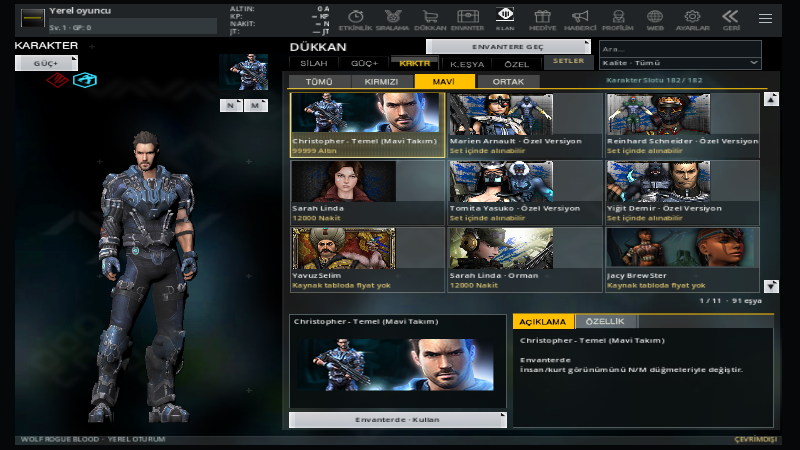
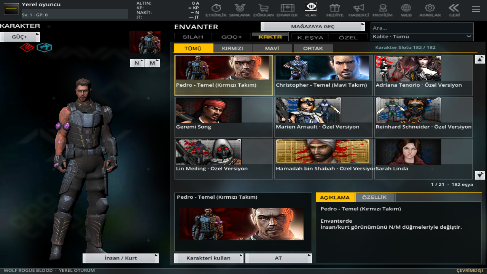
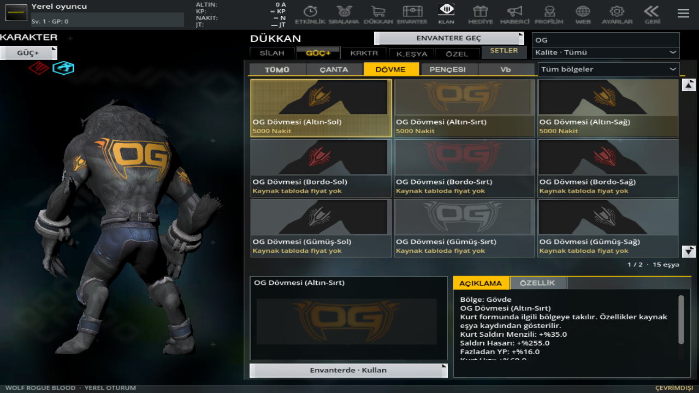
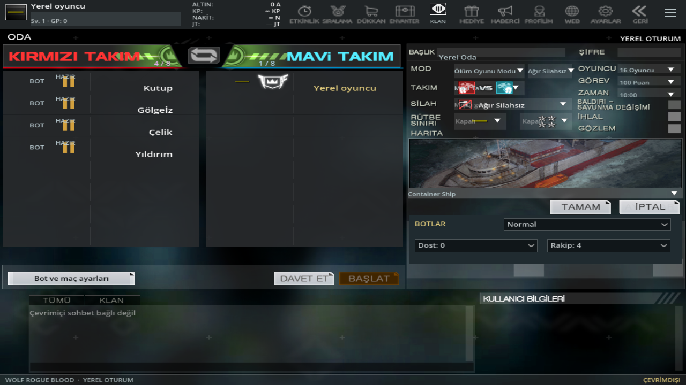
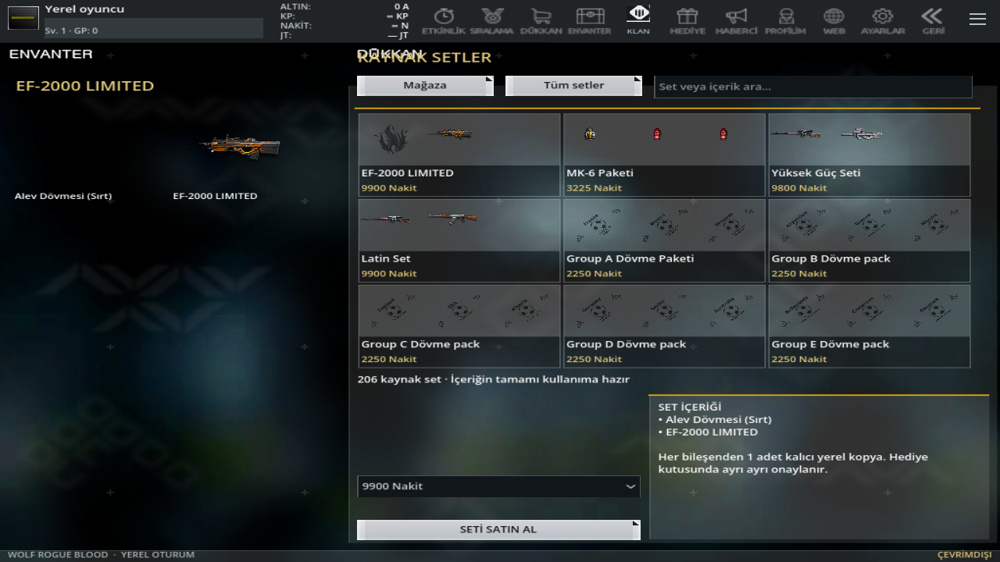

# 0.18: telefona uyan üst menü, özgün kartlar, OG ve kaynak setleri

Üst menü gerçek ekran pikseline göre düzenlenir: düğmeler 44×44 piksel, güvenli alanın içindedir. Dar telefonda sığmayan işlevler **Diğer** menüsünden açılır. ALTIN/KP/NAKİT/JT satırları profil bölümünden ayrılıp özgün sırada bir sütuna hizalandı; GP profil tarafındadır. Nakit/KP ∞, bağlı olmayan JoyToken hesabı — gösterilir. Klan Zinciri ve Wolf Pass kaldırıldı. Eski Pass bağlantısı yerel görevlere gider. Envanterin gövdesi kalan yüksekliğe sığdırılır; saydam 3D önizleme kendi fiziksel en/boy oranında çizilir.

182 kullanılabilir insanın tamamı, kendi erkek/kadın donöründeki **UI_Default_Idle** silahsız menü animasyonuyla doğrulandı. Özgün GLB'ler değiştirilmedi; menü hareketleri [ayrı kaynaktan çıkarıldı](menu-animation-source-018.json). Silah taşıma klibi de korunur; silahsız karaktere uygulanmaz. [164 kart özgün resmine bağlandı](portrait-bindings-018.json). Özgün kartı bulunamayan 18 karakter için kendi modelinden, takım arka planlı kart üretildi; başka karakterin resmi kullanılmadı.

**OG dövmeleri arşivde GM adıyla bulunuyordu.** Önceki “bulunamadı” açıklaması yanlıştı. Altın, Gümüş, Bordo, Lacivert ve Mor kaynak görselleri/kimlikleri bağlandı (18 eşya kaydı). Gövde, sol kol ve sağ kolun ayrı özgün mağaza resimleri kullanılır; ortak UV dokusu kart resmi yerine gösterilmez. Grid sırası **Sol kol — Sırt/Gövde — Sağ kol**. Aynı sarı görseli kullanan üç eski OG kimliği, yeni referans setinin tek kartına bağlandı; mağazada ikinci sarı satır yoktur. 819 kaynak kimliği ve eski sahiplikler korunur; 816 ayrı dövme kartı gösterilir. Modele takılan doku/UV eşleşmeleri korunur. OG’nin saydam tüy katmanının altında kalması çizim sırasıyla düzeltildi; hem önizlemede hem maçta derinlik denetimi korunur. OG gövdesinin UV eksenleri, doğru yön referansıyla düzeltildi; kaynak model/doku, geometri, kemik ağırlıkları ve kol/diğer dövmelerin UV’leri değiştirilmedi. OG çıkarılınca özgün UV yüzeyi geri gelir.

Altın kaynak 12955/20803/21803 kimliklerinin her biri 5.000 Nakit'tir. Kaynak `255` hasar alanı önceki yorumda sıfır bırakılmıştı; artık gerçek sayısal değer kullanılır: üçlü toplam **+765 hasar**, +51 dönüşüm hızı, +48 fazladan YP, +60 zırh, +180 hız. Bunlar arşiv puanlarıdır; PC'nin bütün toplama sınırlarının çözüldüğü anlamına gelmez. 819 dövmenin görünür adları kaynak ailesi/renk/bölgeyle Türkçeleştirildi. Resmî tarihsel satış adı doğrulanamayan türevler için yerelleştirme olduğu [katalogda](../godot/assets/presentation/catalog.json) belirtilir. İnsan/kurt karakter kimlikleri, takım modelleri ve fiyat bağları değişmedi; GM kadın karakteri doğrulanmamış başka bir karakter adıyla sunulmadı.

161 karakterin insan/kurt kaynak performans kayıtları **Özellik** sekmesinde gösterilir. Dövmelerin menzil, hasar, YP ve hızına ek olarak doğrulanmış dönüşüm hızı alanı yerel dönüşüm süresine bağlandı. Zırh kaynak puanı gösterilir; bölgesel savunma ve tüm donma mekanikleri uygulanmış değildir. Eski yanlış `stunRecoveryPercent` yorumu kaldırıldı. [Alan kanıtı](item-stat-fields-018.json.gz).

34 haritanın tamamında artık `mapattribute.dat` içindeki kendi özgün seçme resmi vardır; 15 türetilmiş harita resmi özgünleriyle değişti. Yanlış boyutta atlas kesildiği için boş kalan seçim görseli düzeltildi. 67 kaynak mod kimliğinin görünen adı Türkçedir: İşgal Modu, Kurt Avı Modu, Ölüm Oyunu Modu, Yıkım Modu, Uyku Modu, Kurt Akını Modu ve varyantları. Kimlik/harita kısıtları korunur. Adların bulunması, tüm mod kurallarının oynanabilir olduğu anlamına gelmez; önceki beş kaynak Ölüm Oyunu varyantı ve yerel eğitim/Kurt Avı/Kurt Savaşı/öğretici kapsamı sürer.

## Fiyatlar ve set satın alma

4.934 kaynak satış kaydı ve **695 kaynak set** tarandı. 1.926 içe aktarılmış eşyanın 1.414'ünde doğrudan kaynak fiyatı vardır. Önceden tekil fiyatı bulunamayan **86 eşya**, bütün içeriği kullanılabilir ve fiyatı mevcut setler üzerinden alınabilir. Mağazaya **206 eksiksiz kaynak set** eklendi; diğer setler eksik bileşenle satılmaz. Eşyadaki **İçeren setleri göster** düğmesi ilgili paketlere gider. [695 setin denetimi](source-set-audit-018.json.gz), [özgün tablo](pc_sources_018/setitemdata.dat.gz).

Geriye kalan **426 eşya** için 305 kaynak fiyatı sıfır, 121 kaynak satış kaydı eksiktir. Bunlar ücretsiz kabul edilmez ve tahmini fiyat konulmaz. İnternetteki farklı dönem/bölge ve özel sunucu fiyatları özgün arşiv fiyatı diye aktarılmaz. Nakit ve KP kullanıcının tercihiyle **∞**, Altın ve GP sınırlıdır. Envanter başlangıç eşyaları ve kabul edilmiş hediyelerden oluşur.

Set bedeli ve tüm bileşenler tek atomik kayıtta hediye kutusuna geçer. Kutuda yeterli yer olmaması veya kayıt hatası bütün alımı iptal eder; kısmi eşya verilmez. Tekrar işlem ücret/eşya çoğaltmaz. Bileşenler hediye kutusunda ayrı ayrı kabul edilir. **Yerel uyarlama her bileşenden bir kalıcı kopyadır.** Özgün süre alanları kanıtta korunur; süreli kiralama, paket adedi ve kampanya kurallarının bütünü çözülmüş değildir.

## Video ve web karşılaştırması

Kullanıcının doğruladığı [YouTube oda videosu](https://youtu.be/__oWuPcF2Gw) Higgsfield sahne analiz aracıyla incelendi; doğrudan video indirme bu ortamda 403 verdi. [Analiz kaydı](youtube-room-analysis-018.json) otomatik semantik analizdir; tek tek küçük yazıların elle okunduğu iddia edilmez. 0:15–0:30 oda adı/ayar penceresi ve harita önizlemesi; 0:30–1:00 oda içinden ayar değiştirme ve harita listesi; 1:00–1:15 davet penceresi karşılaştırıldı. Videodaki sağ oda paneli için asıl **interface/changefielddialog** bağlandı. Mod ailesi/varyantı, takım, harita, kaynak puan/süre ve 2–16 yerel oda kapasitesi seçilir; dost/rakip bot sayısı kapasiteye göre sınırlanır (her tarafta en fazla dört bot). İptal gerçek odayı değiştirmez; taslak ekran boyutu değişiminde korunur. Çevrimiçi şifre, giriş/izleyici ve rütbe kısıtları etkinmiş gibi gösterilmez. Özgün harita galerisi korunur; **Davet Et** düğmesi kaynak `gameinvitewindow` penceresini açar. Gerçek sunucu kapsam dışı olduğu için çevrimiçi oyuncu uydurulmaz.

Sonradan gönderilen TikTok kısa bağlantısı mesajlaşma videosuna yönlendi; kullanıcı doğru referansı YouTube olarak düzeltti. O alakasız videonun görüntüleri, kişisel mesajları veya sesi depoya eklenmedi.

Web kaynakları 6 Kasım 2026 tarihinde kontrol edildi:

- [Softnyx Adriana ve sürümleri](https://wolfteam.softnyx-is.com/GameInfo/Character/OneGeneration/adriana.aspx): adlar, SE/Adult ayrımı, Gold/GP bonusları. Bu resmî bölgenin sayısal dengelemesi arşivle aynı değildir; üstüne yazılmaz.
- [Joygame forumunda mod adları/kuralları](https://www.joygame.com/forum/wolfteam/konu/wolfteam-oyun-modlari/5a8c962b-b6e6-4571-96bc-29e3cb3dbdb4): Türkçe mod adlarının tarihsel kontrolü; forum yazısı resmî sunucu fiyat tablosu sayılmaz.
- [Joygame forumunda OG/GM adlandırması](https://www.joygame.com/forum/wolfteam/konu/wolfteam-gm-dovmesi-og-lere-ozel/77f7cb3a-aeb6-476f-85af-f8dec3573ddb): iki adın tarihsel ilişkisi; rastgele forum fiyatları ithal edilmedi.
- [Ejder dövmesi karşılaştırması](https://wolf2team.com/wiki/dovmeler/ejder-dovmesi/): bağımsız/özel sunucu kaynağıdır. Kaynak 12031'in 3/3/3/3/9/3 alan düzeni için ikincil kontrol; güncel Joygame fiyatı veya bütün varyantlar için kesin kanıt değildir.

[297 yeni kontrol](presentation-018-validation.json), genel regresyon ve gerçek OpenGL ekranları sürümün çalışma zamanı özetiyle bağlanır. Fiziksel Android cihaz/emülatör testi ve tam PC piksel/mekanik eşitliği yapılmış sayılmaz.
