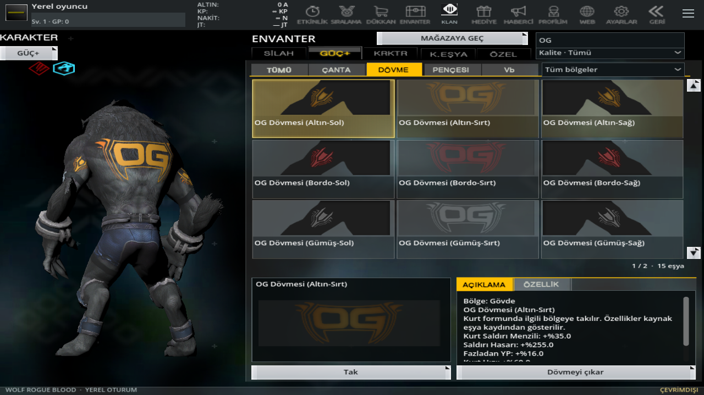
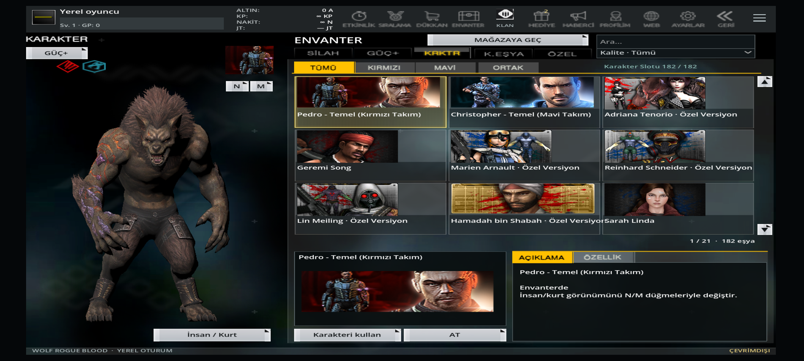
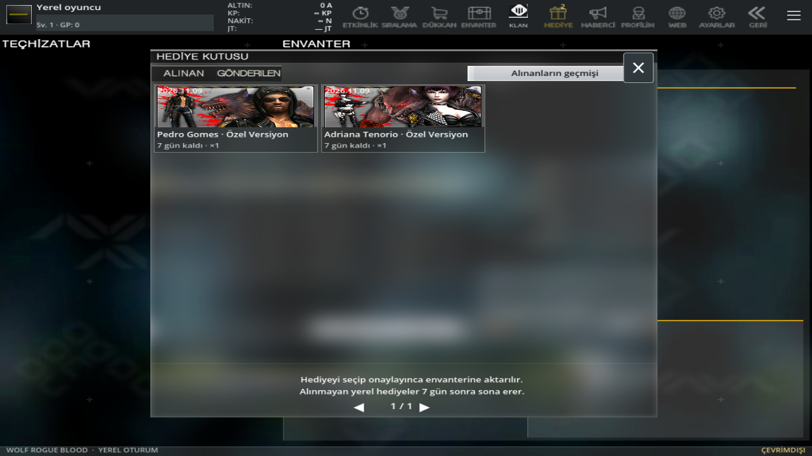
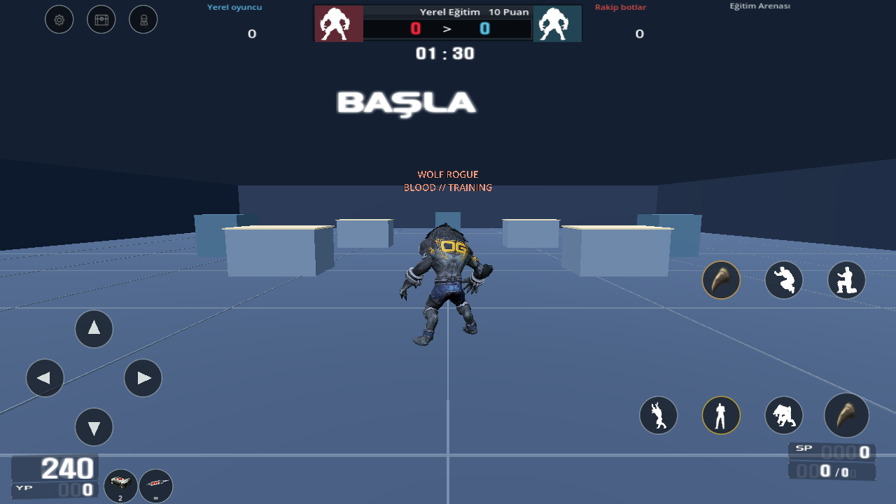

# 0.19 — model çizimi, dokunma alanları ve kurt saldırısı

Diriliş/Reboot kurtların gövdesindeki saydam harmanlama kaldırıldı: gövde artık derinlik tamponuna yazıyor; kürk ve dövme kabukları kendi saydamlıklarını koruyor. Bütün karakter/mutasyon modellerinde sıkıştırılmış köşe verisi, türetilmiş LOD ve gölge ağları kapatıldı. Özgün GLB, iskelet, bağlama ağırlıkları ve doku dosyaları değiştirilmedi. OG'nin doğru yöndeki gövde ve ayrı kol resimleri korunur.

Bu düzenleme kullanıcının **X7 Pro / güncel Android** bildirimi üzerine yapıldı. Masaüstü Compatibility/OpenGL çiziminde erken/geç bekleme pozları ve OG ön/arka görünümü kontrol edildi. **X7 Pro üzerinde kurup denenmedi; telefondaki parçalanmanın tamamen giderildiği henüz doğrulanmadı.**

Üst menü, kullanılabilir alan boyunca yayılır ve ekran çözünürlüğüne göre büyür. 800×450, 1280×720 ve 2712×1220 ölçüleri ile güvenli kenarlar sınanır. Küçük ekranda erişilemeyen bağlantılar Diğer menüsündedir. Ayrı ALTIN/KP/NAKİT/JT sütunu, sınırsız Nakit/KP ve sonlu Altın/GP korunur.

Hediye kutusunda karakterlerin tam doku atlası yerine kendi kart bölgesi kullanılır. Silah ve güç eşyalarında da özgün atlas kesiti uygulanır; görsel kartın resim alanına sığar. Hediye kabulü, sahiplik ve kayıt işlemleri değişmez.

Kurt normal saldırısı sırayla iki ayrı özgün **UMFi1 / UMFi2** klibini oynatır. Sağ saldırının ses/pençe izleri kendi kaynak animasyon olaylarına bağlıdır. UMFi2, 27 kaynak donörden CRC/SHA doğrulanarak ayrı [klip kataloğuna](../godot/assets/gameplay/right-clips.json) aktarıldı; temel modeller yeniden yazılmadı. Kullanıcının istediği %15 artış hem animasyona hem saldırı aralığına uygulanır. Diğer hareketlerin hızı değişmez.

Kükreme her yeni basışta başa döner; önceki kükreme sesi/efekti temizlenir. Kesilen kükreme ek can kazandırmaz. Tamamlanan kükreme YP'yi kapasitesine doldurur; üst üste eklemez. Hasar önce YP'den, kalanı normal candan düşer. Form/karakter/mutasyon değişimi ve yeniden doğuş YP'yi temizler. **Bu çevrimdışı uyarlamanın normal kurt için 200, mutasyon için 99 sınırı bütün PC varyantları için çözülmüş özgün değer değildir.** Resmî [Christopher sayfası](https://wolfteam.softnyx-is.com/GameInfo/Character/OneGeneration/christopher.aspx) ulumada +200 HP bildirir; tarihsel kılavuzlar temel kurt için 99/100 ek kalkan belirtir. Kaynak/bölge farkı [katalogda](../godot/assets/gameplay/howl.json) açık tutulur. Doğrulanmamış kükreme hız çarpanı eklenmedi. SP, silah seçimi puanıdır; YP ile birleştirilmedi. Özgün SP ekonomisi hâlâ tam uygulanmış değildir.

İşaretlenen **KURT KOŞ** düğmesi kurt HUD'undan kaldırıldı. Ayrı takla düğmesi ve 3 metrelik sınır korunur. Takılı yetenekle çift ileri dokunuş koşuyu başlatır. Can/enerji düğmeleri büyütüldü ve artık takılı eşyanın doğru kırpılmış resmini gösterir.

Müzik yönlendirmesi düzeltildi: oda oluşturma/oda/oda ayarı `background/game.ogg`, lobi listesi `background/lobby.ogg` kullanır. Maç ve maç içi duraklatma menüsü lobi müziği başlatmaz; harita ambiyansı ve özgün olay sesleri korunur. Birlikte çalan efektler için ana çıkışa −1 dB tepe sınırlayıcı eklendi. Kullanıcının ayrı hedef ses kaydı bulunmadığı için müziğin duyumsal olarak birebir eşleştiği iddia edilmez.

[45 hedefli kontrol](mobile-019-validation.json), genel regresyon ve 14 yeni gerçek OpenGL fotoğrafı çalışma zamanı özetiyle bağlanır. Fiziksel Android/emülatör testi, gerçek sunucu ve eksiksiz PC eşitliği kapsamda doğrulanmış değildir. 0.18'in fiyatı çözülemeyen 426 eşya ve diğer belgelenmiş sınırları sürer.
