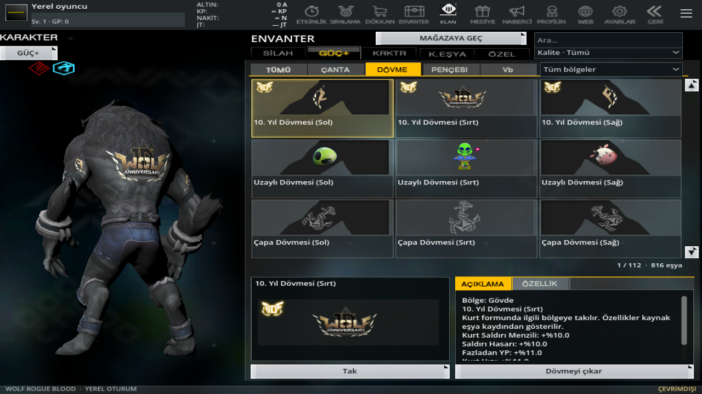
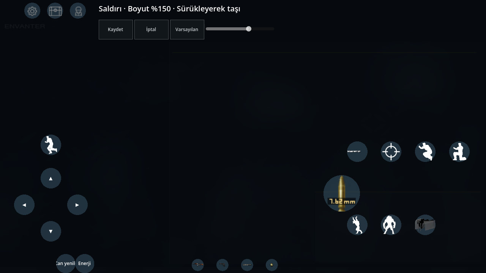
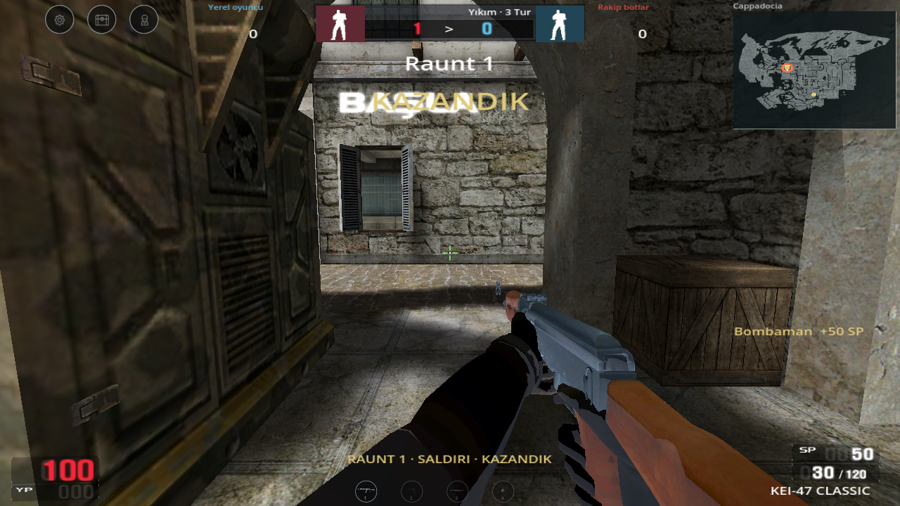

# 0.20 — dövme kartları, dokunma düzeni ve Yıkım turları

819 dövmenin tamamı, özgün `exitemdata.dat` içindeki eşya kimliğinden kendi mağaza görseline bağlandı. Kaynak dosyanın 57 baytlık başlığı ve iki UTF-16 görsel/ölçü alanı dosyanın sonuna kadar çözümlendi; yinelenen kimliklerin resimleri karşılaştırıldı. Kaynakta eksik normal Kelebek kartı için aynı eşyanın özgün büyük kartı kullanıldı. Ham model kaplaması artık mağaza kartında gösterilmez. Sol kol / gövde / sağ kol sırası, tek altın OG satırı, kalite filtreleri ve sahiplik korunur. Bütün sırt dövmelerinde kullanıcının onayladığı OG UV düzeltmesi ve bütün dövme kabuklarında derinlik testiyle çizim sırası uygulanır. Orijinal GLB ve kaplama dosyaları yeniden yazılmadı.

Küçük kaynak düğmelerinin dokunma alanı ekran çözünürlüğüne göre en az 48 temel piksele büyütüldü. Kapatma simgesi ayrıca büyütüldü ve görünmez kaynak sayfaların önüne alındı. Bağlanmamış/devre dışı kontroller aktif düğmelerin dokunuşunu engellemez. Gerçek Viewport GUI tıklamasıyla ayarlar penceresinin kapandığı sınandı.

**Ayarlar → Kontrol → Kontrolleri düzenle:** saldırı, hareket, şarjör/kükreme, dönüşüm, zıplama, takla, nişan/güçlü saldırı, silah yuvaları, can/enerji ve üst menü kontrolleri sürüklenebilir. Seçili düğmenin boyutu %60–%200 arasında ayarlanır. Kaydet, İptal ve Varsayılan bulunur. Konumlar ekran oranıyla saklanır; oyun çizimi ve dokunma alanı aynı ölçeği kullanır. Kayıt hatasında önceki düzen korunur.

Kükreme anında 200 YP vermek yerine animasyon boyunca kademeli yeniler; ortak üst sınır 99'dur. Hasar önce YP'den, kalan miktar candan düşer. Kükreme dışında YP zamanla azalır; dövmenin ek YP tutma alanı azalmayı yavaşlatır, ana canı yanlışlıkla artırmaz. Her basışta yeniden başlayan özgün animasyon/ses/efekt korunur. SP ayrı, sonlu bir maç bakiyesidir; standart set ücretsiz, diğer ekipman/mutasyon seçimleri bakiyeye göre alınır.

**Sayısal sınır:** 99 ortak YP, animasyon süresince dolum, saniyede 1 YP azalma; SP için başlangıç 1000, üst sınır 2000, kişisel öldürmede +100 ve başlangıç dışı eşya/mutasyonda 100 bedel bu sürümün açıkça belgelenmiş çevrimdışı ayarlarıdır. Bütün karakterlerin tarihsel/bölgesel ek YP sınırı ve özgün SP ücret/ödül tabloları çözülmüş sayılmaz. Bu sayılar özgün PC sunucu kodundan kurtarılmış gibi sunulmaz.

Yıkım'ın 3000/3001/3020/3021 kaynak varyantları, bunlara özgün tabloda bağlı altı mevcut haritada açılır: 26, 31, 44, 87, 89, 42. Her haritanın iki `WBombArea` nesnesi kendi konum, yarıçap, kimlik ve dünya özetiyle kullanılır. 42/B merkezine en yakın ağ parçası doğma alanlarına bağlı olmadığı için bot hedefi, aynı özgün yarıçap içinde iki takımdan da yolu bulunan bir noktaya bağlandı; bomba alanı taşınmadı. Oda oluşturma/oda ayarında özgün tur kazanma hedefi ve saniyesi seçilir; 105 saniye **1:45** olarak gösterilir. Süre dolunca tek tur biter; yeni turda oyuncular geri gelir. Hedef sayıda tur kazanan takım maçı bitirir. Tur sırasında ölüm yeniden doğuş vermez. Kırmızı insan formu A/B alanında BOMBA/E basılı tutarak kurar; mavi kurulu bombaya yakınken çözer. Kurulu bomba normal tur sayacından bağımsız ilerler. Botlar bomba alanlarına yönelir ve uygun durumda kurma/çözmeye katılır.

Kurma 3 saniye, çözme 5 saniye, patlama 40 saniye ve tur arası 4 saniye yerel uyarlamadır. Bomba kurulmadan sürenin bitmesinde maviye tur verilmesi bu yerel sürümün açık kuralıdır; tarihsel/bölgesel canlı oyuncu sayısı ve beraberlik kararlarının tamamı özgün sunucu kodundan doğrulanmış değildir. Tek bomba taşıyıcısı/düşen bomba, bütün özel bomba modeli/animasyonları, izleyici kamerası, taraf değişimi ve her tarihsel sunucu beraberlik kuralı henüz tam PC eşitliğinde değildir. Gerçek sunucu kapsam dışıdır.

Altı YouTube bağlantısı için tam video sahne analizi istendi. Beşinin zaman aralıkları tamamlandı; `zBrgxQmGSiw` analizinin durumu [kayıtta](video-analysis-020.json) bulunur. Doğrudan YouTube indirme 403 verdi. Otomatik sahne anlatımları küçük yazıları/mekanikleri yanlış yorumlayabilir; tek tek tüm karelerin elle izlendiği iddia edilmez. Özellikle “HAZIR” yazısının karakter adı diye yorumlanması gibi analiz hataları oyuna aktarılmadı. Diğer videoların haritaları önceki Giriş/İki Tapınak hariç tutmasını değiştirmez.

43 hedefli kontrol, genel regresyon ve 9 yeni gerçek OpenGL ekranı tutulur. Fiziksel X7 Pro/Android veya emülatör testi yapılmış değildir. Önceki 426 çözülemeyen eşya fiyatı ve diğer belgelenmiş sınırlar sürer.
