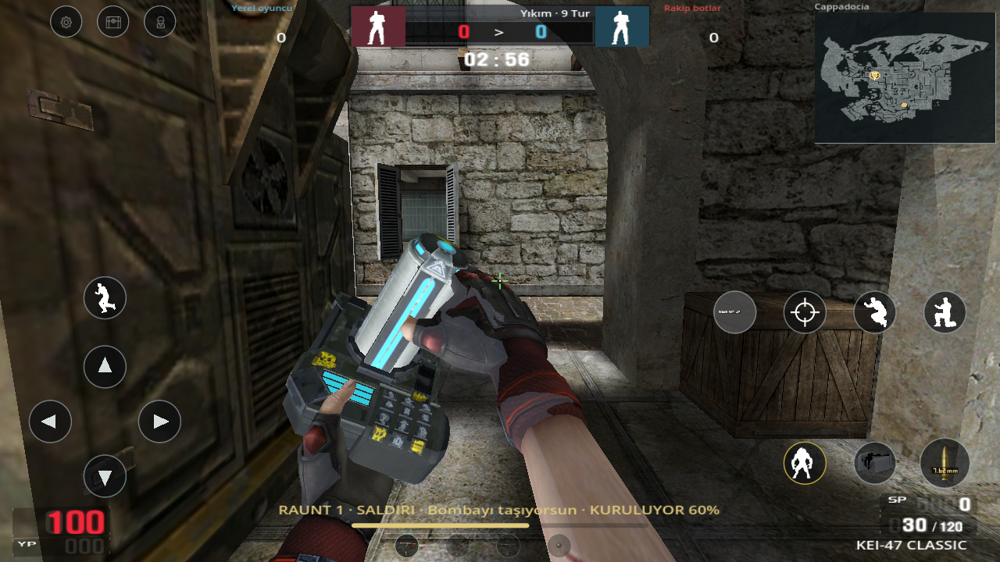
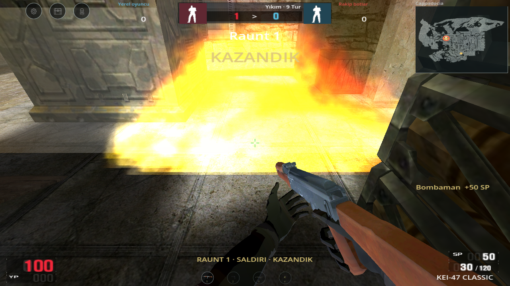
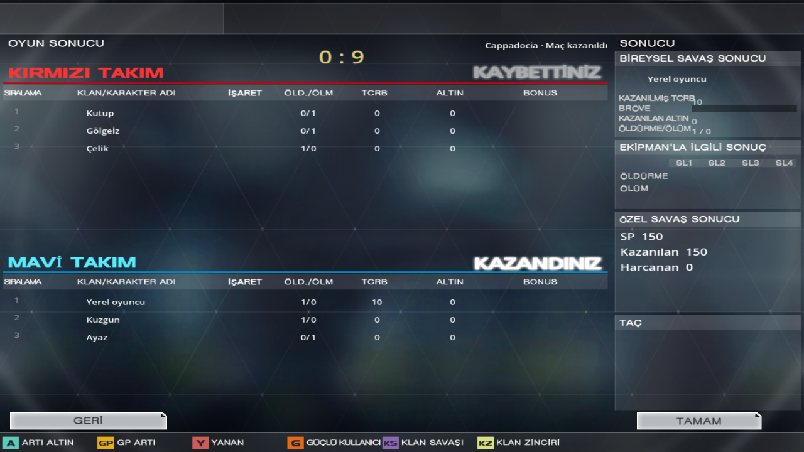

# Video devamı: ikinci paket

Birinci paketin maç kuralları ve kalıcı video yerleşiminin üzerine özgün bomba cihazı, animasyon/ses olayları, patlama ve sonuç ekranları eklendi. İki paket `codex/mobile-continuation` dalındadır. Bu çalışma kaynak kodudur; son yayımlanan imzalı APK 0.20.0'dır ve bu değişiklikleri içermez.

- PC arşivindeki `WT_PV_TIMEBomb` el/cihaz modeli, dört özgün dokusu, `Select` ve `Fire` klipleri aktarıldı. Kurma süresi rastgele sayaç yerine 0,666 saniye kuşanma + 4,667 saniyedeki `INSTALL_TIMEBOMB` olayına bağlandı. Birleştirme, düğme ve etkinleştirme sesleri kaynak olaylarında çalar. Bırakınca silah geri gelir; işlem sırasında ateş, şarjör ve dürbün engellenir.
- Düşen/kurulan bomba özgün `groundtimebomb` modeliyle görünür. 40 saniyelik süre üst ortada kaynak turuncu sayı atlasıyla gösterilir. Kurma/çözme ilerlemesi mevcut alt ipucu bölgesindedir. Patlamanın kaynak efekti ve sesi tur kararı sırasında kaybolmaz; izleme kamerası da mesafeye göre sarsılır. Parçacıkların ilk karede yanlış boyutta görünmesi düzeltildi.
- Videoda okunabilen mutasyon seçim fiyatları Normal 50, Güç 250, Koruyucu 900, Hayalet 500 SP olarak bağlandı. Otomatik normal doğma ve seçim süresinin dolması ücretsiz kalır; açık kart seçimi gösterdiği tutarı öder. Silah fiyatları ve öldürme/seri ödüllerinin belirsiz değerleri hâlâ açık yerel dengedir.
- Maç sonu ilk görünüm, kaynak `gr_cc_bg` üstündeki dört üst kart ve sol alt beşinci alanı kullanır. Ayrıntı görünümü kaynak `gr_bg`, özgün takım satırları ve bireysel sonuç alanıdır. Ayrıntı/Geri ve Tamam düğmeleri videodaki yerlerindedir; sonuç sayfasına lobi üst menüsü eklenmez. Tamam aynı ayarlı odaya döner, odadan tekrar başlanabilir.
- Kartlar ve ayrıntılar gerçek yerel öldürme/ölüm, kafadan isabet, kazanılan GP/altın ve kazanılan/harcanan SP'yi gösterir. Bot kimliği ve istatistiği yeni tur/yaşam boyunca korunur. Sonuç görünümünü değiştirmek ödülü tekrar vermez. Çevrimiçi klan/rütbe ödülü uydurulmaz; bilinmeyen alanlarda çizgi bırakılır.

Model/doku/klip/ses kökenleri ve SHA-256 özetleri [bomba kaynak kaydında](bomb-source-022.json) tutulur. Modeli yeniden çıkarmak için `python tools/import_bomb_022.py --help` kullanılabilir. Kaynak sonuç kareleri [ödüller](review/video-reference/result-awards-12m54.png) ve [ayrıntılar](review/video-reference/result-details-12m58.png) olarak korunur. Yerleşimin devam eden kuralı [VIDEO_YERLESIM_KURALI.md](VIDEO_YERLESIM_KURALI.md) içindedir.

`mobile_022.gd` 32, `video_layout_021.gd` üç ekran oranında 318 kontrolü geçti. Tam [doğrulama raporu](mobile-validation.json), Python testleri, kaynak içe aktarımı ve Godot regresyonlarının tamamını içerir. [Birinci paketin dokuz](update-021-visual-validation.json) ve [ikinci paketin on](update-022-visual-validation.json) gerçek OpenGL görüntüsü güncel çalışma zamanı özetine bağlıdır.

Özgün çözme el klibi henüz doğrulanmadığı için kurma klibi çözme diye oynatılmaz; çözme kendi ilerlemesini kullanır. Cihazın kamera konumu mobil uyarlamadır. İnsan örneğindeki 330 can formülü, mutasyon YP tabanları/toplama yöntemi ve bazı denge değerleri tam PC davranışı olarak doğrulanmış değildir. Fiziksel Android testi yapılmadı; bu oturumda Android SDK ve mevcut imzalama anahtarı bulunmadığından yeni APK üretilmedi.
