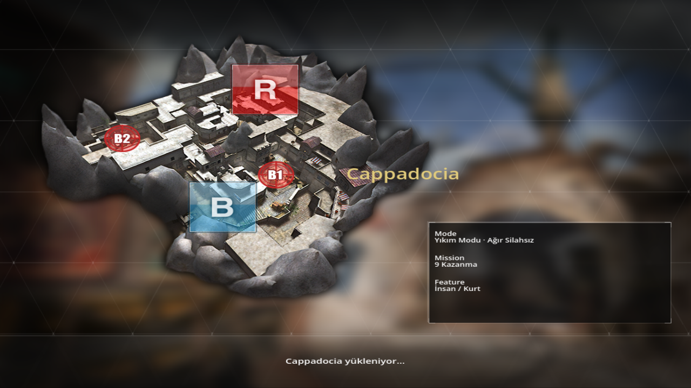
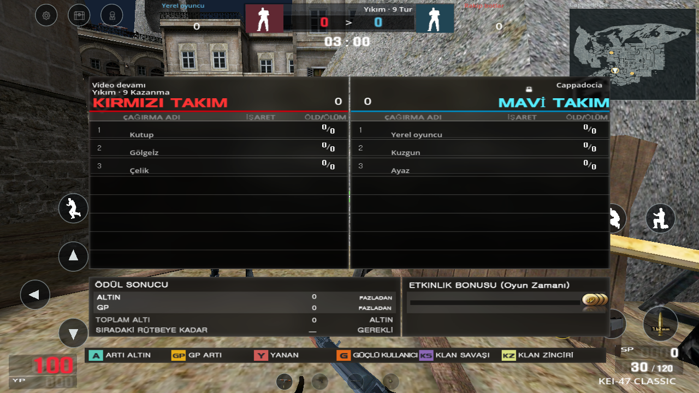
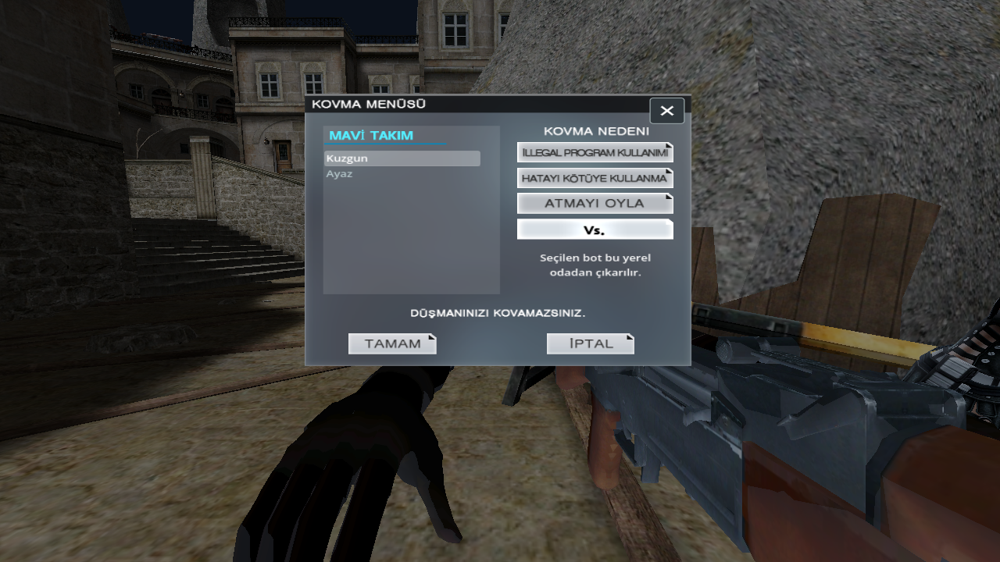

# İkinci aşamanın kalanları

Önceki iki kod paketinin üzerine, incelemede açık kalan oda/maç ekran zinciri ve temas efektleri tamamlandı. Kaynak sürümü 0.23.0'dır; son yayımlanan imzalı APK 0.20.0 bu değişiklikleri içermez.

- Odadaki Başlat düğmesi aynı oda görünümünün üstünde özgün 3–2–1–GO atlasını gösterir. İkinci kez Başlat aynı maçı çoğaltamaz. Geri sayımı iptal etmek oda ayarlarını ve önceki maçı değiştirmez. Sayım sırasında oda verisi değişirse istek iptal edilir.
- GO'dan sonra kaynak `section/load` ekranı açılır. Gerçek harita sahnesi `ResourceLoader` ile yüklenir; uydurma ağ bekleme durumu veya yüzde gösterilmez. Kaynak adı tam eşleşen yükleme görseli kullanılır; eşleşmeyen harita başka haritanın resmiyle doldurulmaz. Harita hazır olunca ekipman/HAZIR aşamasına geçilir.
- İlk hazırlık seçimden ayrı saat kullanır; erken Standart seçmek HAZIR süresini atlatmaz. Kaynak BAŞLA grafiği yalnız başlangıçta kısa süre görünür. Maç içindeki yeniden doğma/form seçimi oyuncu girdisini kilitlerken diğer botları ve maç saatini durdurmaz.
- Tab veya mevcut yuvarlak skor düğmesi, oyunu durdurmayan gerçek takım tablosunu açar. Ölen bot satırı kaybolmaz; kaydedilmiş öldürme/ölüm ve soluk ölüm görünümü korunur. Bilinmeyen bot rütbesi, ağ pingi, klan üyeliği veya etkinlik bonusu üretilmez. Yıkım turu bitince kısa sonuç bandını aynı kaynak tablo izler; sonraki hazırlıkta kendiliğinden kapanır. Tur skoru ve kişisel öldürme ayrı kalır.
- Oda önizlemesi, maç tablosu ve kovma listesi aynı Kırmızı/Mavi bot adlarını kullanır; Yıkım odasında sonradan insan doğacak rakibe yanlış kurt etiketi basılmaz.
- Videodaki Kovma Menüsü, özgün konum/atlaslarıyla bağlandı. Çevrimdışı sürümde yalnız kendi takımındaki yerel bot seçilebilir; seçilen gerekçe tutulur, bot oda sayısından çıkarılır ve yeni turda aynı kimlikle geri getirilmez. Taşıyıcı bot çıkarılırsa tek bomba yere düşer. İşlem öldürme/SP vermez, ağ oylaması veya gerçek oyuncu kovması gibi sunulmaz.
- Sol/sağ pençe ve vücut saldırısı, çözülmüş klipteki `FIRE_KEY` temasında hasar verir. Temas tekrarı ikinci isabet üretemez. Menü, seçim, form değişimi, ölüm ve animasyon kesilmesi bekleyen teması temizler. Gerçek isabet, kaynak `Impact_Flesh` efektini tetikler; dost hedef/ıskalama aynı etkiyi üretmez. Pençe izi kendi kaynak uç kemiklerini ve `spline` aralığını kullanmaya devam eder. Çözülmemiş kliplerde önceki açık yerel hasar davranışı korunur.
- Ölümün kırmızı ekran tepkisi tek olaydan başlar ve izleyici geçişinde kısa süre söner. Yeni yaşam/tur bu geçici tepkiyi sıfırlar. İsabet atlasının yarım harf gösteren kesimi düzeltildi. HUD önbelleği tur/kurulu bomba/hazırlık değişimlerini de izler; HAZIR, normal süre ve bomba sayacı üst üste kalmaz.
- Çözme çubuğu ve “Bomba imha ediliyor” yazısı [15:33 kaynak karesindeki](review/video-reference/defuse-15m33.png) konumlarına bağlandı. Kaynakta da elde silah göründüğü doğrulandı; kurma el klibi çözme diye oynatılmaz. Kurma sırasında alt ipucu bölgesindeki ek ilerleme, açık mobil yardımcı olarak kalır.

Referans kareleri: [oda sayımı · 00:36](review/video-reference/room-countdown-00m36.png), [tur tablosu · 02:32](review/video-reference/round-scoreboard-02m32.png), [kovma · 07:37](review/video-reference/kick-menu-07m37.png). Hepsi verilen dördüncü Drive kaydındandır. Ölçülen konumlar [kalıcı yerleşim kuralına](VIDEO_YERLESIM_KURALI.md) eklendi; mevcut can/YP, SP/cephane, radar, menü ve hareket/eylem tuşları taşınmadı.

## İki aşamanın kapsam karşılığı

| İnceleme maddesi | Kod ve kabul kaydı |
|---|---|
| Karakter/eşya/dövme bazlı YP, SP olayları ve gerçek seçim bedelleri | `match_economy.gd`, `mobile-match.json`, [birinci paket](PC_REFERANS_021.md), `mobile_021.gd` |
| Rol değişimi ve ölüm sonrası dost kamera/HUD'u | `destruction.gd`, `spectator.gd`, `mobile_021.gd` |
| Cihaz, el/kuşanma/kurma, iptal, tek taşıyıcı ve ayrı bomba süresi | `bomb_presentation.gd`, [özgün model ve olay kaydı](bomb-source-022.json), `mobile_022.gd` |
| Tur sonucu, ödül/ayrıntı ve ayarlı odaya dönüş | `match_scoreboard.gd`, `pc_screens.gd`, [ikinci paket](PC_REFERANS_022.md), `mobile_022.gd` ve `mobile_023.gd` |
| Oda sayımı, gerçek yükleme, hazırlık ve canlı Tab | `match_flow.gd`, `match_flow_page.gd`, `match_scoreboard.gd`, `mobile_023.gd` |
| Kovma penceresi ve çevrimdışı işlemi | `local_kick_page.gd`, `remove_local_bot`, `mobile_023.gd` |
| Doğru olaya bağlı pençe/iz/ses/isabet/ölüm ve patlama | `actor_source_events.gd`, `claw_trail.gd`, `combat_feedback.gd`, `clientfx_instance.gd`, `mobile_022.gd` ve `mobile_023.gd` |

`mobile_023.gd` sayım/iptal, gerçek harita yükleme, ayrı hazırlık, canlı saat ve skor, üç ekran oranında kaynak tablo sınırları, bot çıkarma ve temas olaylarını sınar. [Hedefli sonuç](mobile-023-validation.json), [tam regresyon](mobile-validation.json), [13 yeni gerçek OpenGL görüntüsü](update-023-visual-validation.json). Önceki paketlerin ve ekipman seçiminin görüntüleri de güncel çalışma zamanı özetiyle yeniden bağlanır.

Bu kapsam, bütün PC oyununun eşitliği değildir. İnsan örneğindeki 330 can formülü, YP toplama/mutasyon tabanları ve bazı silah/seri ödülü değerleri kaynakta bütünüyle çözülmüş değildir. Özgün çözme el klibi ve desteklenmeyen ClientFX düğümleri tamamlanmış sayılmaz; çözme kendi doğru ilerleme durumunu kullanır. Gerçek sunucu, ağ oylaması ve fiziksel X7 Pro kabulü bu çevrimdışı kod testlerinden çıkarsanmaz. Bu ortamda Android SDK ve mevcut imzalama anahtarı bulunmadığından yeni APK üretilmedi.
