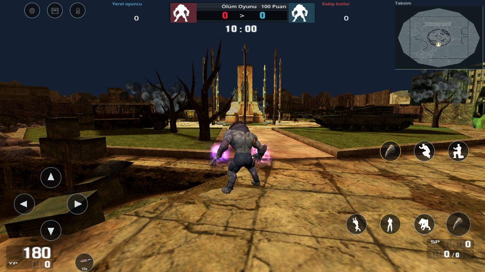
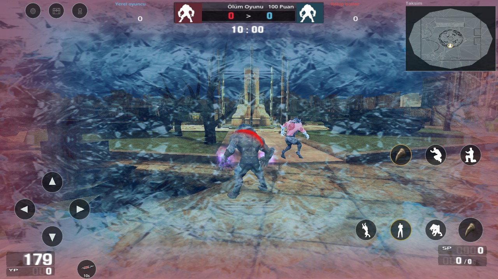

# İki yeni kurt kaydı · 0.24.0 kaynak güncellemesi

**0.25 düzeltmesi:** Bu tarihsel belgedeki Mor Pençe–el parlaması bağlantısı yanlıştı. Parlama etkin FT/enerji paketine aittir; [düzeltilmiş davranış ve kanıt](PC_REFERANS_025.md). Aşağıdaki 0.24 sonuçları eski çalışma zamanına aittir.

İki Drive dosyası indirildi ve gerçek dosyalar üzerinden incelendi: **11:54.803** ve **33:09.486**, toplam **45:04.289**. Dosya kimlikleri, SHA-256 değerleri, görüntü/ses akışları ve inceleme yöntemi [makine kaydında](video-wolf-review-024.json) bulunur. Önceki YouTube analiz servisinin yanlış süre/içerik döndüren açıklamaları uygulama kanıtı olarak kullanılmadı.

İki akışın tamamı çözüldü; zaman çizelgesinin sonuna kadar iki saniye aralıklı 22 temas paftası incelendi. Kısa hareketler ayrıca saniyede sekiz kareyle incelendi. Bu yöntem, videoların normal hızda kesintisiz oynatıldığı veya sesin işitsel olarak birebir karşılaştırıldığı iddiası değildir. Ses akışları çözüldü; tam ses miksajı eşitliği doğrulanmış değildir.

## Görülen davranış ve uygulama

| Referans | Uygulama |
|---|---|
| Video 1 · 01:30, ayakta kurt kadrajı; video 2 · 00:41–00:43, koşu/sıçrama/duvar teması | Fazla yakın kamera düzeltildi. Varsayılan uzaklık 6.2, hedef yüksekliği 1.0; bunlar görüntüden ayarlanan mobil kamera değerleridir, çözülmüş PC motor sabitleri değildir. Kamera hâlâ gerçek duvarda geri çekilir. Geometri `VideoLayout` içinde tutulur. |
| Yan, geri ve çapraz hareket; çömelme; havada uzayan poz ve yere iniş | 27 özgün animasyon vericisinden 16 ek klip, toplam **432** klip kaydı çıkarıldı. Yan/geri/çapraz hareket kendi kemik izlerini kullanır. Kalkış bitince yerde koşmak yerine `LJT`, gerçek zemin temasında `LJL` oynar. Hasar ve saldırı hızı bu klipler için değiştirilmedi. |
| Video 1 · 04:20 ve video 2 · 00:41, ellerden uzanan mor efekt | **Eski ve yanlış eşya eşleştirmesi (0.25 ile kaldırıldı):** takılı 16018 için kaynak `wolf_Hand_glowL/R` efektleri el soketlerine bağlandı. Renk, doku, ömür ve örnekleme kaynak veriden gelir; bu eşya/efekt eşleştirmesi ve boyut kazancı açık bir görsel mobil uyarlamadır. Kaynak PC eşya bağı çözülmüş gibi sunulmaz. Parçacık boyu her parçacığın ömrünü izler; grubun yaşına göre bütün parıltıyı küçültmez. Derinlik sınaması korunur. Eşyayı çıkarma/form/menü geçişi parıltıyı temizler. Saldırı şeridi ayrı kaynak kemik uçlarını ve spline aralığını korur. |
| Video 2 · 00:51–00:53 ve Taksim bölümü, buzlu ekran/karakter görünümü | `lockedinice` kaynak dokusu ve renk eğrisi kamera görüntüsünü kaplar. Önceki küçük dünya karesi kaldırıldı. Kabul edilen buz formu isabeti görsel buz tabakası başlatır; üst üste vuruşlar tek etkiyi yeniler. Süre bittiğinde önceki malzemeler geri yüklenir. **3.5 saniye efekt ömrüdür; PC donma/yavaşlama süresi olarak kullanılmaz.** Yeni sersemletme, hareket cezası veya ilave hasar eklenmedi. |
| Ölüm ekranı ve kafadan isabet | Ölümde özgün `Deathdirecting` dokusu ve 0.662 saniyelik kaynak eğri oynar. Yeni yaşam temizler. Gerçek kafadan isabette `BloodHeadshot` eklenir. Bu ekran/blood eğrilerindeki saydamlık yönü ayrı doğrulandı; diğer bütün ClientFX gruplarına toplu alfa terslemesi yapılmadı. |
| Silah kuşanma, dürbün ve şarjör | Kuşanma, mevcut modelde varsa gerçek `Select` klibini oynatır. Dürbünle yeniden doldurma başlayınca dürbün kapanır; el/şarjör görünür ve normal görüş açısı geri gelir. Bırakılan nişan sıradan silah görünümüne döner. |
| Bomba kurma/çözme, ses, oda ve sonuç ekranları | Önceki [0.22](PC_REFERANS_022.md)/[0.23](PC_REFERANS_023.md) kaynak cihazı, el/kurma klipleri, olay sesleri, tek taşıyıcı, ayrı bomba saati, çözme çubuğu, oda/HAZIR/tablo/sonuç zinciri korunup yeniden sınandı. Bu iki yeni kayıt çoğunlukla kurt maçıdır; önceki silah/bomba kayıtları bu davranışların referansı olmaya devam eder. |
| HUD, can/YP, SP, radar, skor ve mobil tuşlar | Mevcut kaynak konumları değiştirilmedi. Yeni ekran efektleri HUD'un altında kalır ve dokunmayı yakalamaz. Kalıcı [yerleşim kuralı](VIDEO_YERLESIM_KURALI.md) sürer. |

Yeni hareket paketleri verici başına sıkıştırılır ve gerektiğinde yüklenir. Ham GLB'ler yeniden yazılmadı. Kaynak dosya ve iskelet özetleri dışa aktarımda, paket özetleri testte doğrulanır. Android dışa aktarım filtresi `.json.gz` dosyalarını içerir; çalışma zamanı parmak izi de bu dosyaları kapsar.

## Doğrulama ve görüntüler

**67 hedefli kontrol** ve tam regresyonun **32 aşaması** geçti. [Hedefli test](mobile-024-validation.json), [tam regresyon](mobile-validation.json) ve [14 yeni gerçek OpenGL görüntüsü](update-024-visual-validation.json). Kaynak başına karşılaştırma kareleri:

- [Ayakta kurt · 01:30](review/video-reference/new-standing-wolf-01m30.png)
- [Uluma · 01:32](review/video-reference/new-wolf-roar-01m32.png)
- [Mor iz · 04:20](review/video-reference/new-purple-run-04m20.png)
- [Duvar/sıçrama · 00:42](review/video-reference/new-wolf-wall-jump-00m42.png)
- [Buz/isabet · 00:51](review/video-reference/new-wolf-frost-00m51.png)
- [Taksim yükleme · 15:30](review/video-reference/new-taksim-loading-15m30.png)

Görüntü serisi eğitim alanındaki sabit pozları, eldeki gerçek Taksim haritasını, buz/ölüm ekranlarını, kuşanmayı ve dürbün/şarjör geçişini gösterir. Önceki bomba, oda, sonuç ve ekipman serileri de aynı çalışma zamanı için yeniden alınır.

## Açık kalan eşitlik sınırları

Bu paket bütün PC oyununun veya videodaki her pikselin eşitliği değildir. Yeni kayıttaki OG gibi kaplamaların birebir kaynak kimliği eldeki arşivde doğrulanmadı. Buz tabakasının UV görünümü ve mor pençenin eşya bağlantısı görsel uyarlamadır; yeni kayıttaki bütün özel aura/buff türleri ve PC durum kuralları çözülmüş değildir. Dürbün maskesi önceki mobil çizimdir. Bütün silahlara özgü namlu efekti bağlantıları ve bazı ClientFX düğümleri hâlâ eksiktir. Sesin dalga biçimi/miksaj eşitliği ve gerçek telefon performansı doğrulanmadı.

34 harita korunur. Yeni videolarda görünen Giriş, önceki kullanıcı hariç tutması nedeniyle eklenmedi; Taksim mevcut 97 numaralı kaynak haritadır. Çevrimdışı kapsam ve mevcut ağ/ödül sınırları değişmedi. **Yeni APK üretilmedi:** güncel kod 0.24.0, son doğrulanmış imzalı APK 0.20.0'dır.
