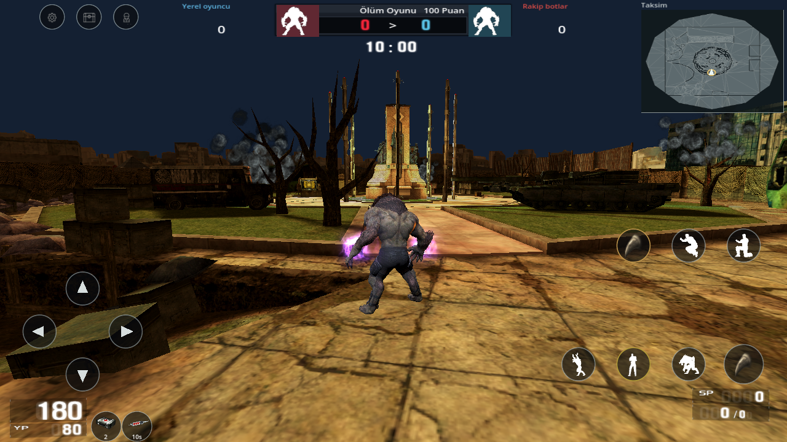
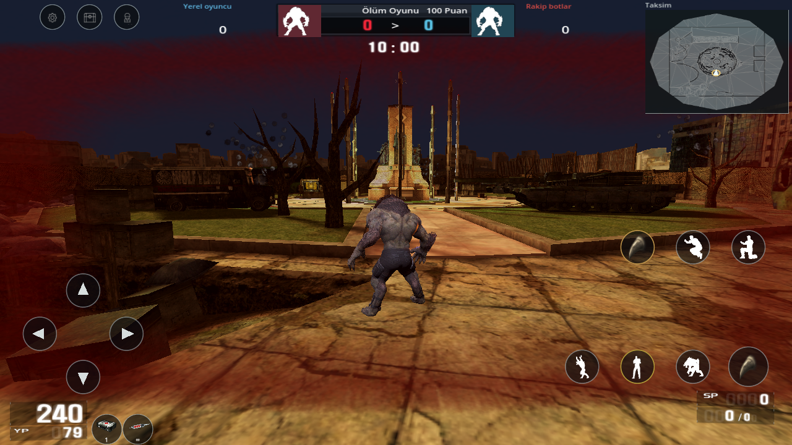

# 0.25 · FT/enerji düzeltmesi ve yeniden video incelemesi

Önceki sürümde mor el parlamasını Mor Pençe'ye bağlamak yanlıştı. Parlama yalnızca başarıyla kullanılan FT/enerji paketinin etkin olduğu sürede başlar. İlk uzun kaydın 02:48–02:50 karelerinde aynı pençe dururken ana can **200 → 150 → 147**, ayrı uluma havuzu **198** olarak kalır. [Önce](review/video-reference/ft-hp-168s-025.png), [etkinleştirme](review/video-reference/ft-hp-169s-025.png), [devam](review/video-reference/ft-hp-170s-025.png).

## Düzeltilen davranışlar

- Paket sahipliği parlamayı başlatmaz; T veya enerji düğmesi başarılı kullanımı başlatır. Normal/Nakit enerji ayrı kaynak can bedeli ve normal/güçlü saldırı katkılarını kullanır. Hız, gerçek hareket ve devam eden koşu klibinin temposuna yansır.
- Etkin FT tekrar ücret kesmez veya üst üste eklenmez. Süre sonu, ölüm, tur sonu, yeni yaşam ve insan formuna geçiş geçici etkileri temizler. Duraklama süreyi dondurur.
- Enerji paketi tekrar kullanılabilir; kullanım kalıcı paket sahipliğini tüketmez. F/ilk yardım ana canı iyileştirir, ayrı uluma/YP havuzunu değiştirmez. Normal ilk yardım yaşam başına bir, Nakit ilk yardım iki kullanımdır. Tam can ve tükenen kullanım hakkı yeni kullanım kabul etmez.
- Kaynak ilk yardım ekran efekti ve kaynak el efektleri gerçek kullanımlara bağlıdır. El parlaması pençe değişiminden bağımsızdır. HUD'da ilk yardım kalan hakkı, enerjide etkin süre veya tekrar kullanım işareti görünür.
- AK-47 kaynak modelindeki **Flash ve breach** soketleri ayrı korunur; atışta özgün `AK-47_PV_Muzz` grubu oynar. Bıçakta ve boş şarjörde namlu parlaması oluşmaz. Dönüştürülen birinci şahıs görünümündeki parçacık boyutu açık bir mobil görsel uyarlamadır. Diğer silahların tamamı için özgün efekt bağlantısı çözülmüş değildir. Kaynak soket çıkarımı `tools/import_muzzle_025.py` ile kaynak SHA-256 denetlenerek yeniden üretilebilir.
- Menü, HUD, HP/YP, SP, skor, süre, radar ve cephane konumları kalıcı video yerleşim kuralını izler. Önceki kullanıcının kontrol düzeni ayrı tercihtir.

## Yeniden incelemenin kapsamı

Drive üzerinden sağlanan altı oyun dosyasının toplamı **74:53.352**. Dört önceki kaydın 31, iki kurt kaydının 22 temas paftası baştan sona zaman sırasıyla yeniden incelendi. Uzun eski kayıtlarda 1 saniye, iki yeni kayıtta 2 saniye; kısa kayıtlarda 0.5 saniye aralıklı örnekler kullanıldı. FT'nin değişim anı özgün çözünürlüklü karelerden ayrıca karşılaştırıldı. 10 saniyelik ekran kaydının 243 karesini içeren beş pafta ve son promptun metni de yeniden incelendi. Bu kayıt normal hızda kesintisiz oynatma veya işitsel ses eşitliği iddiası değildir.

Silah kaydındaki dürbün/şarjör geçişleri, bomba kurma/çözme, ayrı bomba saati, takım seçimi, HAZIR, oda/sonuç zinciri; kurt kayıtlarındaki koşu, çapraz hareket, çömelme, havada saldırı, iniş, buz/ölüm ve enerji görüntüleri mevcut uygulamayla karşılaştırıldı. 0.21–0.24'teki değişiklikler de yeni APK'ya dahildir; son eski APK 0.20 olduğu için yalnız bu turun düzeltmeleriyle sınırlı değildir.

## Açık kalan farklar

Kaynak paket açıklamasındaki hız `+50/+100` biriminin gerçek hareket hızına dönüşümü çözülmedi. Mobil hız katsayıları **1.10/1.15** açık uyarlamadır. Kaynakta süre **10 saniye**, devam eden can/iyileşme değeri **dakika başına** yazılıdır; kayıtların bazı bölümlerindeki daha hızlı can değişimi ve uzun parlama ile tam uyuşma çözülmedi. Kaynak metnin birimi sessizce saniyeye çevrilmedi. Anlık Nakit enerji bedeli %25, Normal enerji %50 olarak ayrıdır.

Videoda FT parlaması buz görüntüsüyle birlikte görülebilir. Bu yüzden enerjiye varsayımla tam donma/görsel bağışıklığı eklenmedi. Bütün karakterlerin temel canını videodaki farklı 200/320/330 örneklerine eşitleyen bir kural uydurulmadı. Modern OG kaplamalarının tam kimliği, bütün silah efekt bağlantıları, bomba alanındaki yeşil/beyaz ışının özgün bağı, bütün modlar ve ses miksajının birebir eşitliği tamamlanmış değildir. Mevcut 34 harita korunur; önceki Giriş/İki Tapınak hariç tutması sürer.

## Yeni oyun görüntüleri

## Test ve APK

**36 hedefli davranış kontrolü ve tam regresyonun 33 aşaması geçti.** **210 gerçek OpenGL görüntüsü** güncel çalışma zamanı özetiyle bağlandı; bütün görüntü grupları hatasız tamamlandı. [Hedefli kontrol](mobile-025-validation.json), [regresyon](mobile-validation.json), [yeni görüntüler](update-025-visual-validation.json), [bütün video inceleme kaydı](video-audit-025.json).

Önceki imza anahtarı bu ortamda bulunmadığı için yeni APK **Wolf Rogue Blood Test**, `com.wolfrogue.blood.offline.test` kimliğiyle ayrı kurulacak şekilde üretildi. Eski uygulamayı silmez veya kayıtlarını taşımaz. Aynı test kimliği ve özel test anahtarı sonraki test güncellemeleri için korunur; anahtar/parola depoya eklenmez. **Teslim edilen APK: 1.573.199.303 bayt (1.57 GB)**; ARM64/ARMv7/x86_64, API24+, hedef36. [Paket ve imza raporu](android-offline-test-build-025.json): 40 katalog, CRC, kaynak bağlantıları, v2/v3 imza ve 16 KiB ZIP hizalaması doğrulandı. İzin listesi boş. Çalışma alanındaki indirme kopyası aynı SHA-256 ile doğrulandı: `db9a7e0bdd07956b914fa62ed86bca1206f18b9bf3378d31460a5cd4b9320522`. Fiziksel telefon testi yapılmadı.

Derleme notu: Godot Android dışa aktarımı Linux üzerinde ara APK için sabit `/tmp` yolunu kullanır; yalnız TMPDIR yeterli değildir. Bu teslim özel derleme konteynerinde geçici yol RAM alanına alınarak üretildi. Teslimden sonra yalnız yeniden üretilebilir Godot import önbelleği boşaltıldı; özgün varlıklar ve kod korundu.
