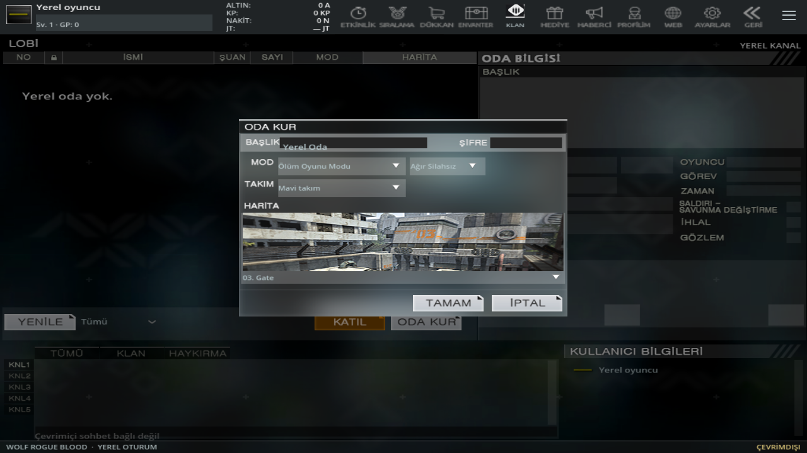
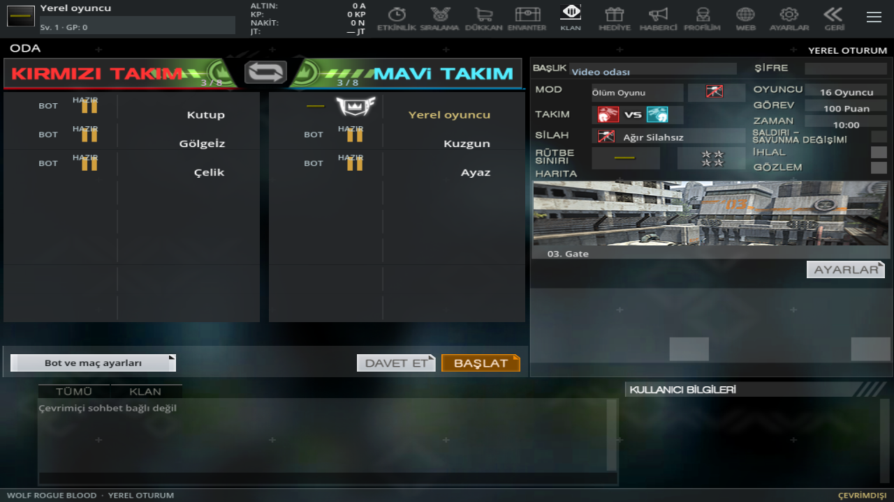

# 0.26 · Uzun kayıt incelemesi, giriş ve oda akışı

Önceki 0.25 incelemesi aralıklı kare ve temas paftası incelemesiydi; normal hızda kesintisiz izleme değildi. Kullanıcının itirazından sonra uzun dosyalar, bütün video karelerini ve sesini koruyan ardışık kısa MP4 parçalarıyla sahne çözümlemesine gönderildi. Bu da bir insanın gerçek zamanda her kareyi tek tek doğruladığı anlamına gelmez. Otomatik açıklamaları doğrudan PC davranışı saymadık.

Erişilen altı oyun dosyası toplam **74:53.352**: 33:09.486, 11:54.803, 15:55.339, 13:20.067, 00:22.443 ve 00:11.215. İki yeni kurt kaydının toplamı 45:04.289; ayrıca bir 45 dakikalık dosya saptanmadı. Dosyaların SHA-256 değerleri önceki indirmelerle eşleştirildi. Uzun kayıtlar en fazla iki dakikalık ardışık parçalara, açıklaması eksik kalan veya işlemi başarısız olan aralıklar daha kısa parçalara ayrıldı. Kaynak kare hızı korundu, ses çıkarılmadı; paftalar hareketli video girdisinin yerine kullanılmadı. İşlem kimlikleri, süreler ve açık sınırlar [inceleme kaydında](video-audit-026.json).

## Görüntüyle doğrulananlar

- 33 dakikalık kaydın **00:12 / 05:59 / 33:07** karelerinde kırmızı/mavi takım listeleri solda, oda bilgileri ve harita sağda, sohbet ve kullanıcı bilgileri altta. Başlat/hazır düğmesi takım listesinin sağ alt ucunda. [Oda](review/video-reference/room-at-0012-026.png), [oda sahibi](review/video-reference/room-owner-at-0559-026.png), [maçtan odaya dönüş](review/video-reference/room-return-at-3307-026.png).
- **06:03** karesinde açılan hediye kutusunda Enerji Paketi (Nakit) açıkça görünüyor. Mor parlama pençe eşyası sahipliği değildir. [Kaynak kare](review/video-reference/energy-gift-at-0603-026.png).
- Aynı kaydın ilk yaşamında **00:39 → 00:40 → 00:41**, ana can **320 → 240 → 320** olurken ayrı YP yaklaşık **201** kalıyor. Enerji bedeli ve ardından ilk yardım ayrı olaylardır. Sonraki daha küçük can değişimleri, düşman darbeleriyle karışan bölümlerden ayrı değerlendirilir. Her karakterin canını 320 yapacak bir kural çıkarılmadı.
- Koşma, çapraz hareket, sıçrama, havada pençe, duvara tutunma, buz görüntüsü, ölüm/yeniden seçim, skor ve odaya dönüş; silah kaydında dürbün, şarjör, silah geçişi, bomba kurma/bekleme/çözme ve yeni tur mevcut uygulamayla karşılaştırıldı. Yorumcunun kamerası, kanal girişleri, müzik klibi ve Windows hata şakası oyun ekranı olarak eklenmez.
- Çözümleme bazı pençe izlerini "enerji mermisi", olağan inişi "zemin patlaması", oyuncu hareketini "hız rampası" diye tarif etti; bazı parça sonlarına gerçek olmayan final/kararma ekledi. Bunlardan yeni bir FT mermisi, otomatik kamera hareketi, güneş saati değişimi veya zafer kuralı üretilmedi. Kaynak kare karşılaştırması bu sınırlamayı özellikle doğruladı.

## Bu sürümdeki değişiklikler

- Girişte kaynak ad penceresiyle yerel oyuncu adı düzenlenir. Geçersiz ad veya kayıt hatası eski adı bozmaz. Yerel sunucu satırı lobiye gider; oda yokken Hızlı Başlat gerçek oda kurma ekranını açar.
- Kaynak **createfield** penceresinde başlık, mod ailesi, gerçek oyun seçeneği, takım, harita fotoğrafı ve harita seçimi özgün koordinatları kullanır. Oyun seçeneği alanındaki yanlış bot zorluğu kaldırıldı. Bot sayısı/zorluk/kapasite/puan/süre ayrı isteğe bağlı ayar penceresindedir.
- Oluşturma ve oda ayarları harita galerisinde aynı taslağı kullanır. İptal/geri henüz uygulanmamış ayarı kaydetmez; boyut değişimi Unicode başlığı ve seçimi korur. Ayarları uyguladıktan sonra Geri eski pencereyi yeniden açmaz.
- Kaynak kırmızı/mavi oyuncu satırları gerçek yerel oyuncuyu ve maça girecek botları gösterir. Botlar açıkça BOT olarak işaretlidir; sahte uzak hesap, ping veya rütbe eklenmedi. Takım değiştirme oyuncuyu gerçek takımına taşır; kendi satırına dokunmak gerçek yerel profile, Geri aynı odaya döner. Lobi satırındaki oda adı, durum, kişi sayısı, mod ve harita gerçek oda verisidir; mod filtresi çalışır.
- Gizli ayarların kapatma düğmesinin ana ekrana taşarak boşta kalması düzeltildi. Diğer menüler simgesi fontta bulunmayan karaktere bağlı olmadan çizilir.
- **3–2–1–başla** sayımı özgün `count_3.wav`–`count_0.wav` dosyalarını kullanır. Yeniden çizim sesi tekrarlamaz; uygulama askıya alındığında sayaç ilerlemez. İptal sayım sesini durdurur. Hızlı harita yüklemesi son sesin bitişini kesmez; maç hazırlığı ayrı durumdur.
- Tam regresyonda Ruins #72 üzerinde yeniden üretilen bir sorun bulundu: kaynak takım doğma noktalarından biri sadece iki poligondan oluşan, yarım metrelik kopuk navigasyon parçasına düşüyordu. Bu nokta elendi; aynı kaynak takım bölgesindeki **97** geçerli nokta korundu. Test eşiği gevşetilmedi; gerçek bot hareketi ve bilinen hatalı koordinatın dışlanması sınandı.

## Kapsam ve doğrulama

0.21–0.25 değişiklikleri, FT/ilk yardım düzeltmesi, kaynak hareket/efektler, 34 harita ve 903 silahlık katalog bu teslimde korunur. Önceki Giriş/İki Tapınak hariç tutması sürer. Bilinen üç haritadaki kopuk karşı takım rotaları yeni bir tam rota olarak sunulmaz; botlar erişilebilir kendi bölgesinde dolaşır.

FT hız biriminin tam PC dönüşümü, kaynak açıklaması ile videodaki süre/can akışı farkı, modern kaplamaların bütün kimlikleri, her silahın özgün efekt bağı, tüm PC modları ve birebir ses miksajı tamamlanmış değildir. Çevrimiçi sunucu eklenmedi. Bu sürüm bütün PC oyununun eksiksiz eşiti diye işaretlenmez.

Hedefli [45 kontrol](mobile-026-validation.json), [tam regresyon](mobile-validation.json) ve [yeni 19 gerçek oyun görüntüsü](update-026-visual-validation.json) ayrı kaydedilir. Bütün görüntü grupları aynı çalışma zamanı özetiyle yeniden alınır. Fiziksel Android cihaz testi yapılmadı.

## İmzalı Android teslimi

[0.26.0 Test APK](https://github.com/gkggl3616-jpg/wolfd-rogue-blood/releases/download/v0.26.0-offline-test/WolfRogueBlood-0.26.0-test.apk) · **1.573.207.809 bayt**. Ayrı test kimliği `com.wolfrogue.blood.offline.test` eski üretim kurulumunu ve kayıtlarını korur. Önceki 0.25 test anahtarı sürdürülür; özel anahtar depoda değildir.

[Denetim raporu](android-offline-test-build-026.json): ZIP CRC, 23.424 kaynak bağı, 40 katalog, ARM64/ARMv7/x86_64, v2/v3 imza ve ZIP hizalaması geçti. ARM64/x86_64 yerel kitaplıkları 16 KiB sayfaları destekler. API24+, hedef36, izin listesi boş. SHA-256: `d9e24955c4a77709ada64eaa5c8176619d5e9959a1d33528d41b1e1988bb2878`. İndirilebilir kopyanın özeti RAM’de denetlenen imzalı paketle aynıdır.

**34/34 regresyon aşaması ve 229 gerçek OpenGL görüntüsü** çalışma zamanı `c38c9ddb0871e75e3221e721a59623e5212fbd73a026cc67fe12b31efc73a0e2` için doğrulandı. Bu, fiziksel Android cihazında test edildiği anlamına gelmez.
