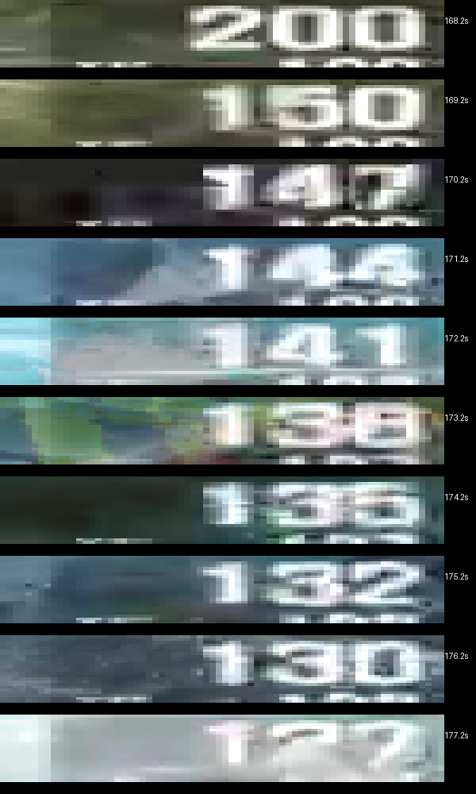
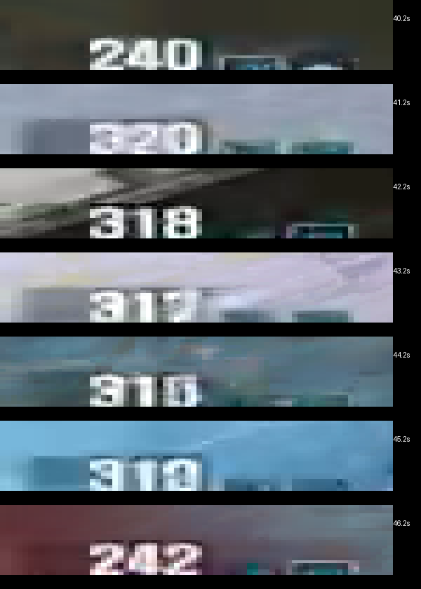
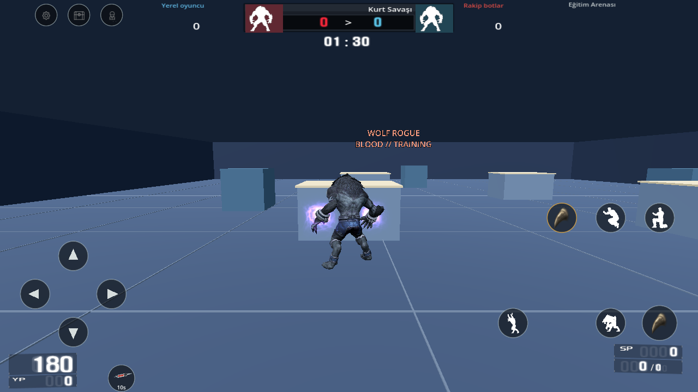
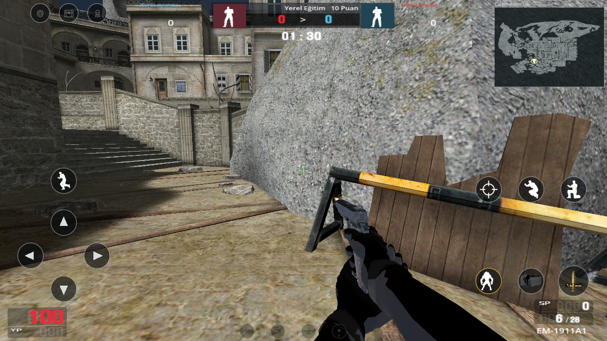

# 0.27 · FT can akışı, silah efektleri ve kaynak yüzeyler

Kapsam, kullanıcının son yanıtıyla **önce çevrimdışı Android** olarak sabittir. Çevrimiçi sunucu bu teslimde yoktur. 34 harita, 903 silah kaydı, önceki giriş/oda/maç akışı ve kalıcı video yerleşimi korunur. Bu sürüm bütün PC içeriğinin eksiksiz eşiti olarak işaretlenmez.

## İnceleme ve FT düzeltmesi

[0.26'daki 74:53 hareket/ses incelemesi](video-audit-026.json) korunur. Bu güncellemede FT'nin belirsiz kalan iki bölümü özgün kare hızında, sesli **12 ve 6 saniyelik hareketli kliplerle** yeniden incelendi; [işlem kayıtları](video-audit-027.json). Otomatik açıklamalar tek başına oyun kuralı sayılmadı. Aynı aralıkların özgün çözünürlükteki can/süre alanları bağımsız karşılaştırıldı.

13:20'lik kayıtta 168.2–177.2 saniyelerde **200 → 150 → 147 → 144 → 141 → 138 → 135 → 132 → 130 → 127** görülüyor. Bu dizi `floor(150 × .98^n)` ile uyuşur. Kesirli can korunur; her saniyenin kaybı ayrı tamsayıya yuvarlanmaz. Oyun sayacı gerçek saniyede bir ilerler. 33 dakikalık kayıtta ilk yardım ve FT birlikteyken **320 → 318 → 317 → 315**, `floor(h × .98 + 5)` ile uyuşur. Önceki düşük çözünürlüklü okumadaki 315/312 yorumu düzeltilmiştir.

Kaynak `exitemdata.dat` alanları da aynı tik mantığını destekliyor: Nakit FT ilk %25, sonra mevcut candan saniyede %2, süre 10 saniye; Altın FT ilk %50, sonra saniyede %5, **ikili kaynak süresi 7 saniye**. İlk yardım +50/+100 anlık, ardından saniyede +2/+5, 15 saniye; yaşam başına kullanım 1/2. Çevirideki dakika başına ifadesi ve Altın için +10 metni, ikili alanlar ve videoyla çelişiyor. [Ham başlık/alan/kaynak kanıtı](power-timing-source-027.json).

Enerji ve ilk yardımın bağımsız tik saatleri, uzun karede süre bitişi, HP kesirleri, dışarıdan hasar, duraklatma ve yaşam sıfırlaması ayrı korunur. Mor el efekti yalnız etkin FT'ye bağlı kalır. **Hız +50/+100 biriminin PC dönüşümü henüz doğrulanmadığı için mevcut açık mobil hız uyarlaması korunur.** Bütün karakterlerin canı videodaki tek hesap gibi 320 yapılmaz.

## Silah namlu efektleri

903 özgün silah satırının PV/UI model, kaplama, çizim tarzı, konum, PV efekt adı ve sonraki HH model sınırı yapısal olarak çözüldü. Her satırdaki model kimliği ayrı doğrulandı. **641 kayıtta kaynak efekt ve özgün Flash soketi**, **255 kayıtta boş/EffectMuzzle alanı** bulunuyor. Boş alanlara rastgele namlu efekti eklenmez. Aynı geometriyi paylaşan varyantlar kendi efekt alanını kullanır.

**162 özgün LTB** dosyasının SHA-256, kemik sırası, hiyerarşisi ve soket dönüşümü çözüldü. 162 modelin tamamı gerçek Godot silah kuşanma akışında sınandı. **44 kaynak efekt grubu** gerçek saldırıyla çalıştırıldı ve OpenGL ile görüntülendi. UZAS-12'de mesh/kemik ad çakışmasının Godot tarafından eklenen sayısal son eki, ancak bütün kemik sırası/hiyerarşisi uyuştuğunda kabul edilir. Impact EM-32'nin erken dönen fırlatıcı dalında atlanan namlu efekti düzeltildi. Parçacık boyutu/eğrisi çizimi açık mobil uyarlamadır; tam PC renderer eşitliği değildir. Kütüphane silahlarının kamera yerleşimi ve doğrulanmamış sayısal silah ayarları da mevcut mobil uyarlamadır; çözülen kaynak konum alanları tek başına PC kamera/istatistik eşitliği sayılmaz.

Yedi roket kaydı `WT-RL2_PV_Muzz` istiyor; verilen ClientFX tanımlarında bu grup yok. Bu yedi kayıt tamamlanmış gibi işaretlenmez. [903 satırın kaynak kanıtı ve açık kayıtlar](weapon-fx-source-027.json).

## Harita yüzeyleri ve bot yolu

34 haritanın **1.841 ayrı materyali**, özgün DTX `userFlags` alanı ve `surface.txt` ile karşılaştırıldı: 1.836 bilinen bayrak, 40 yüzey tanımı, 168 ateş geçirgen materyal. Davranış, dosya adında ahşap yazmasına göre tahmin edilmez. Kaynak **Wood (30) geçirmez**, **Wood Door (100) en fazla 60 kaynak birim / .96 m** geçirir. Hasar/menzil çarpanları kaynak alanlardan gelir; belirsiz yüzeyler engeller. Üç dekoratif SPR ve tanımsız 25/90 bayrakları açık tutulur. [Kaynak raporu](surface-source-027.json).

Mermi en yakın gerçek çıkış üçgenini bulur; aynı dünya çarpışma gövdesindeki ikinci panel veya aradaki engel atlanmaz. İnce panel, kalın panel, iki geçirgen panel, arada engelleyen ahşap ve belirsiz yüzey fizik testleri vardır. Giriş/çıkışın sağlanan özgün efekt ve sesleri kullanılır; bıçak duvardan geçirilmez. Seçili haritalarda istenen üç yüzey sesi de arşivde yoktur: `guns/snd/impacts/cloth/impact1.wav`, `impact2.wav` ve kaynakta bu yazımla geçen `wt_snd/fxsnd/mpact_rubbera.wav`. İsim düzeltilip başka ses özgünmüş gibi kullanılmaz. Fırçaya özel bütün PC yüzey istisnaları çözülmüş değildir.

Ruins, Bridge ve UnderWorld için dokuz daha sık navigasyon pişirmesi denendi; bunlar tek başına karşı takım yolunu çözmedi ve kabul edilmedi. Daha geniş geçiş aday aramasından yalnız gerçek kapsül kalkış/iniş testini geçen yollar alındı. Toplam **85 bağlantı / 249 fizik kontrolü** geçti. **UnderWorld #106 karşı takım rotası artık hem bağlantı grafiğinde hem 77 noktalı gerçek motor yolunda hedefe ulaşıyor.** Ruins #72 ve Bridge #37 hâlâ kopuk; görünmez zemin, ışınlanma veya doğrulanmamış PC sıçrama değeri eklenmedi.

## Görünüm ve açık farklar

GM kaynak adlarıyla saklanan dört OG insan/kurt çifti ve 18 OG dövme kaydı zaten katalogda mevcuttur. Dört kurt çifti ön/arka gerçek koleksiyon önizlemesinde yeniden incelendi. Bu, videolardaki her modern kaplamanın/hesap ekipmanının kimliğinin çözüldüğü anlamına gelmez. Kaynakta mevcut OG modelleri yanlışlıkla eksik diye sayılmaz.

Açık kalanlar: iki kopuk bot rotası; sağlanmayan yedi roket efekt bağı ve üç haritanın `am_fire_sm_loop.wav` sesi ile üç yüzey ses dosyası; FT hız birimi; bütün karakter/silah/mermi/özel mod PC davranışları; modern görünüm eşlemelerinin tamamı, gömülü ışık haritaları ve birebir ses/efekt çizimi. 67 kaynak modun dokuzunda özgün form/puan/süre ve mevcut yerel çatışma akışı vardır; kalan 58'i başka kuralla sessizce açılmaz. Fiziksel Android cihaz testi yapılmadı. Bu nedenle **“0 eksik” sonucu verilmez.**

[Hedefli FT/silah/yüzey kontrolü](mobile-027-validation.json), [tam regresyon](mobile-validation.json), [yeni 58 gerçek oyun görüntüsü](update-027-visual-validation.json), [bot fizik raporu](bot-traversal-validation-015.json). İmzalı paket raporu aşağıdadır.

## İmzalı APK

[0.27.0 Test APK](https://github.com/gkggl3616-jpg/wolfd-rogue-blood/releases/download/v0.27.0-offline-test/WolfRogueBlood-0.27.0-test.apk) · **1573507390 bayt**. [ZIP, kaynak, ABI ve imza raporu](android-offline-test-build-027.json): 41 katalog, 23424 kaynak bağı; ARMv7/ARM64/x86_64; v2/v3 imza ve ZIP hizalaması geçti. ARM64/x86_64 16 KiB sayfaları destekler. API24+, hedef36; izin listesi boş. 0.25/0.26 Test anahtarı korunur.

SHA-256: `c5cc9b89f27da321beb9b6ca72e93228b9223b50549d15da72a287a938d23d0f`. Çalışma zamanı: `bc06363f6a33473630d2b7d621eb280c34945e71c8d9a2543fcf7ade9d2b36e8`. 35/35 regresyon aşaması ve 287 OpenGL görüntüsü bu aynı çalışma zamanına bağlıdır. Fiziksel cihaz ve Android emülatörü denenmedi.
