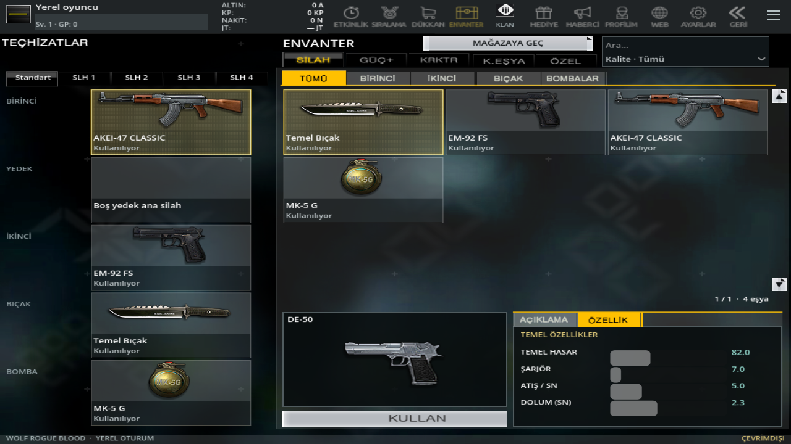
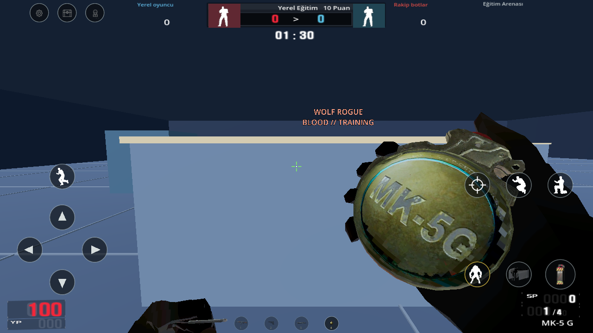
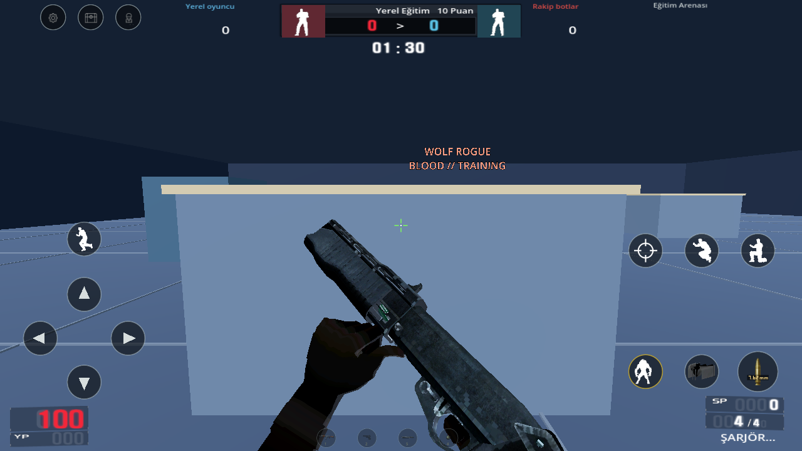
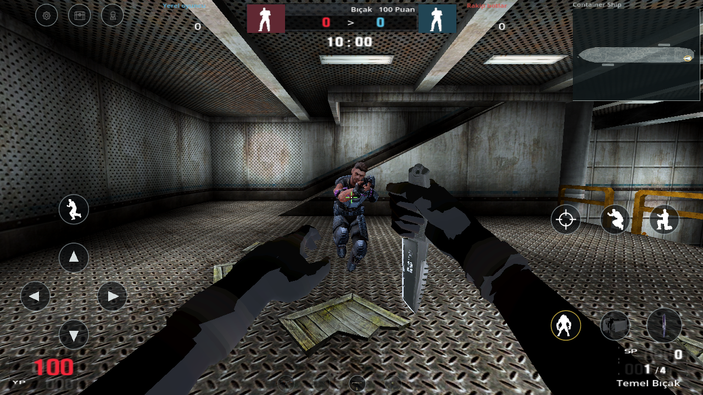
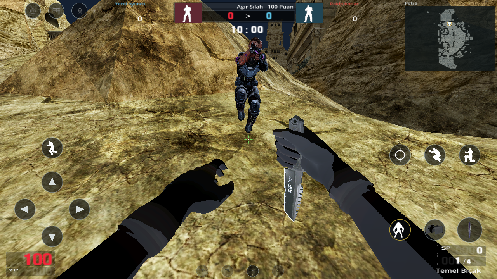
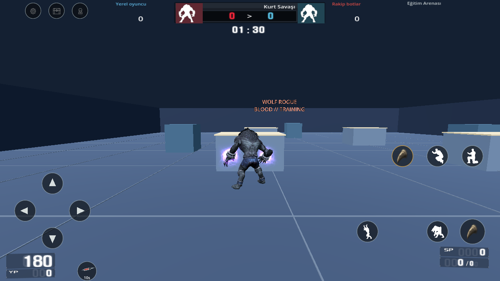

# 0.28 · Gerçek oyun fotoğrafları

40 görüntü, Godot 4.7.2 / OpenGL Compatibility çalıştırmasından alındı. Telefon veya APK ekran çekimi değildir. Bu güncellemede APK hazırlanmadı/yayımlanmadı. Menü, HUD ve mobil tuşların göreli konumu korunur.

[Ayrıntılı değişiklikler ve açık farklar](../../PC_REFERANS_028.md) · [Diğer güncel ekran klasörleri](../) · [Görüntü hashleri ve çalışma zamanı raporu](../../update-028-visual-validation.json)

Yeni silah temel değerleri, gerçek bomba kemik hareketleri, pompalı dolumu, uçan modeller, beş kaynak silah modu ve FT aşağıdadır. Özel mühimmatların bütün PC yetenekleri, tam aydınlatma eşitliği ve iki kopuk bot yolu tamamlanmış sayılmaz. FT örneğinde yerel normal kurt canı 100 → 75 olur; bu bütün PC karakterlerinin canının 100 olduğu iddiası değildir.

## Seçili görüntüler

Kaynak özellikler: DE-50

HGrenadeTimed hazırlama hareketi

SUPAS: bir mermi eklendikten sonra

Kaynak modda gerçek bot/ekipman: Bıçak

Kaynak modda gerçek bot/ekipman: Ağır Silah

Etkin FT: can bedeli ve mor el efekti

## Fotoğrafların tamamı

| Görüntü | Dosya |
|---|---|
| ATGrenadeTimed2 elde | [Aç](ATGrenadeTimed2-held-native-028.png) |
| ATGrenadeTimed2 bırakma hareketi | [Aç](ATGrenadeTimed2-native-postfire-028.png) |
| ATGrenadeTimed2 hazırlama hareketi | [Aç](ATGrenadeTimed2-native-prefire-028.png) |
| HGrenadeTimed elde | [Aç](HGrenadeTimed-held-native-028.png) |
| HGrenadeTimed bırakma hareketi | [Aç](HGrenadeTimed-native-postfire-028.png) |
| HGrenadeTimed hazırlama hareketi | [Aç](HGrenadeTimed-native-prefire-028.png) |
| Mine elde | [Aç](Mine-held-native-028.png) |
| Mine bırakma hareketi | [Aç](Mine-native-postfire-028.png) |
| Mine hazırlama hareketi | [Aç](Mine-native-prefire-028.png) |
| Etkin FT: can bedeli ve mor el efekti | [Aç](ft-active-health-cost-and-hand-effect-028.png) |
| FT etkinleştirilmeden önce | [Aç](ft-before-activation-028.png) |
| Ana menü | [Aç](home-source-interface-028.png) |
| Giriş ekranı | [Aç](login-source-interface-028.png) |
| Kaynak özellikler: AKEI-47 CLASSIC | [Aç](native-properties-AKEI-47%20CLASSIC-028.png) |
| Kaynak özellikler: DE-50 | [Aç](native-properties-DE-50-028.png) |
| Kaynak özellikler: FullMoon | [Aç](native-properties-FullMoon-028.png) |
| Kaynak özellikler: SUPAS PT | [Aç](native-properties-SUPAS%20PT-028.png) |
| Kaynak el/silah kamera konumu: AKEI-47 CLASSIC | [Aç](native-viewmodel-AKEI-47%20CLASSIC-028.png) |
| Kaynak el/silah kamera konumu: DE-50 | [Aç](native-viewmodel-DE-50-028.png) |
| Kaynak el/silah kamera konumu: FullMoon | [Aç](native-viewmodel-FullMoon-028.png) |
| Kaynak el/silah kamera konumu: SUPAS PT | [Aç](native-viewmodel-SUPAS%20PT-028.png) |
| Özgün uçan model/efekt: ATGrenadeTimed2 | [Aç](source-flight-model-ATGrenadeTimed2-028.png) |
| Özgün uçan model/efekt: Arrow | [Aç](source-flight-model-Arrow-028.png) |
| Özgün uçan model/efekt: FullMoon | [Aç](source-flight-model-FullMoon-028.png) |
| Özgün uçan model/efekt: HGrenadeTimed | [Aç](source-flight-model-HGrenadeTimed-028.png) |
| Özgün uçan model/efekt: Mine | [Aç](source-flight-model-Mine-028.png) |
| Özgün uçan model/efekt: Missile | [Aç](source-flight-model-Missile-028.png) |
| Kaynak modda gerçek bot/ekipman: Bomba | [Aç](source-weapon-mode-bot-1022-028.png) |
| Kaynak modda gerçek bot/ekipman: Bıçak | [Aç](source-weapon-mode-bot-1023-028.png) |
| Kaynak modda gerçek bot/ekipman: Tabanca | [Aç](source-weapon-mode-bot-1024-028.png) |
| Kaynak modda gerçek bot/ekipman: Keskin Nişancı | [Aç](source-weapon-mode-bot-1025-028.png) |
| Kaynak modda gerçek bot/ekipman: Ağır Silah | [Aç](source-weapon-mode-bot-1026-028.png) |
| Kaynak modun oda ekranı: Bomba | [Aç](source-weapon-mode-room-1022-028.png) |
| Kaynak modun oda ekranı: Bıçak | [Aç](source-weapon-mode-room-1023-028.png) |
| Kaynak modun oda ekranı: Tabanca | [Aç](source-weapon-mode-room-1024-028.png) |
| Kaynak modun oda ekranı: Keskin Nişancı | [Aç](source-weapon-mode-room-1025-028.png) |
| Kaynak modun oda ekranı: Ağır Silah | [Aç](source-weapon-mode-room-1026-028.png) |
| SUPAS: bir mermi eklendikten sonra | [Aç](supas-one-shell-added-028.png) |
| SUPAS: özgün bitirme hareketi | [Aç](supas-original-finishing-rack-028.png) |
| SUPAS: özgün mermi ekleme hareketi | [Aç](supas-original-shell-insertion-028.png) |
